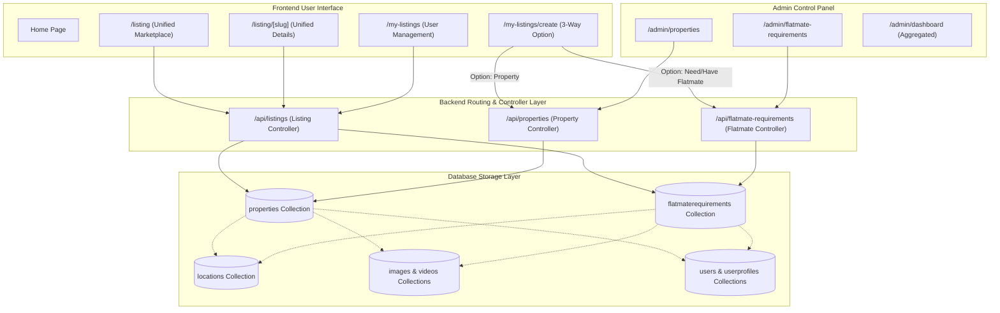
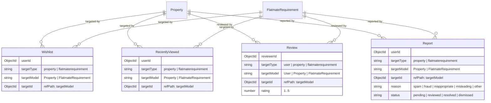
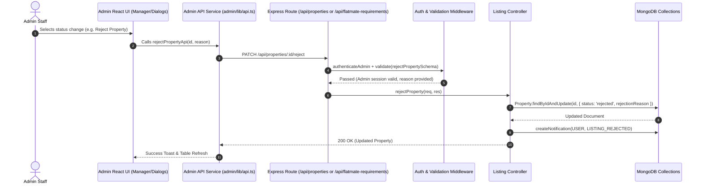
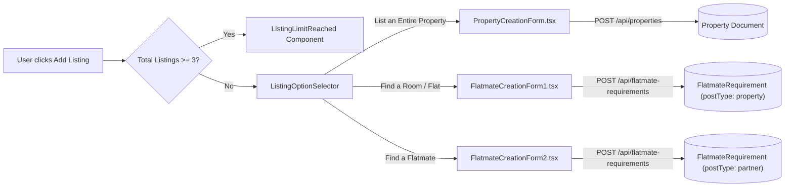
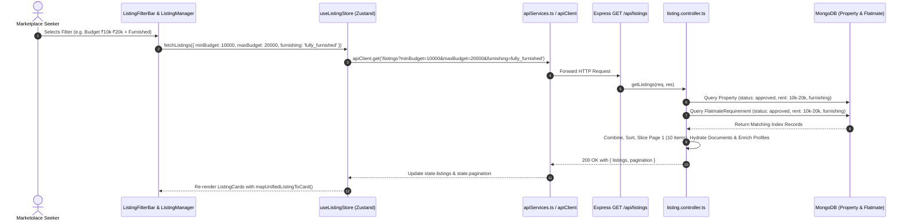
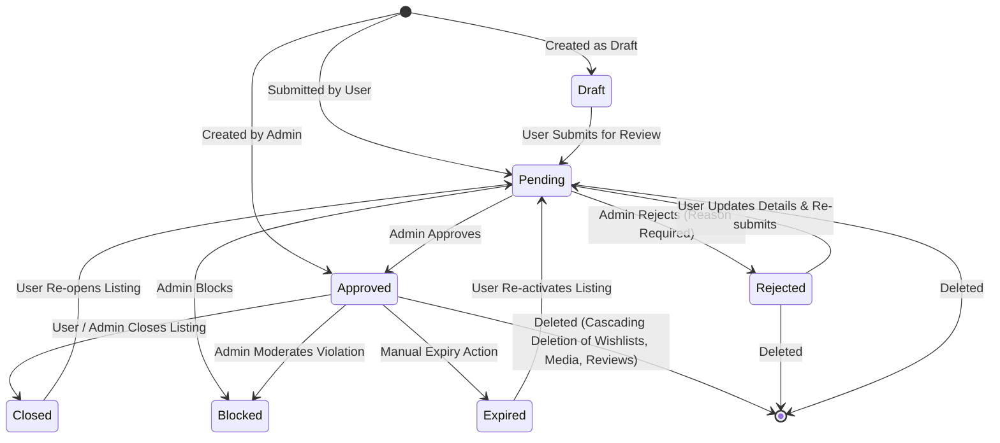

# FlatMate Marketplace: Property & FlatmateRequirement Listing Architecture Analysis

> **Analysis & Architecture Reference Document**  
> **Date:** November 2026  
> **Scope:** `backend`, `admin`, and `frontend`  
> **Target Models:** `Property`, `FlatmateRequirement`, and Unified `Listing`

---

## Table of Contents

1. [Executive Summary & Architecture Overview](#1-executive-summary--architecture-overview)
2. [Backend Architecture Analysis](#2-backend-architecture-analysis)
   - [2.1 Property Module](#21-property-module)
   - [2.2 FlatmateRequirement Module](#22-flatmaterequirement-module)
   - [2.3 Location and Auxiliary Models](#23-location-and-auxiliary-models)
   - [2.4 Backend API & Routes Matrix](#24-backend-api--routes-matrix)
   - [2.5 Shared Backend Logic & Cross-Cutting Concerns](#25-shared-backend-logic--cross-cutting-concerns)
3. [Admin Panel Architecture Analysis](#3-admin-panel-architecture-analysis)
   - [3.1 Property Management Flow](#31-property-management-flow)
   - [3.2 FlatmateRequirement Management Flow](#32-flatmaterequirement-management-flow)
   - [3.3 Dashboard Aggregation](#33-dashboard-aggregation)
   - [3.4 Admin End-to-End Tracing Flow](#34-admin-end-to-end-tracing-flow)
4. [Frontend Architecture Analysis](#4-frontend-architecture-analysis)
   - [4.1 Listing Creation Architecture](#41-listing-creation-architecture)
   - [4.2 Public Listing Discovery & Card Mapping](#42-public-listing-discovery--card-mapping)
   - [4.3 Public Listing Details Resolution](#43-public-listing-details-resolution)
   - [4.4 Search, Filter & Sorting System](#44-search-filter--sorting-system)
   - [4.5 User Personal Listing Management ("My Listings")](#45-user-personal-listing-management-my-listings)
   - [4.6 Frontend End-to-End Tracing Flow](#46-frontend-end-to-end-tracing-flow)
5. [Combined Listing Architecture & Lifecycle](#5-combined-listing-architecture--lifecycle)
   - [5.1 Dual-Collection to Single-Domain Normalization](#51-dual-collection-to-single-domain-normalization)
   - [5.2 Lifecycle Sequence Diagrams](#52-lifecycle-sequence-diagrams)
6. [Existing Field and Options Inventory](#6-existing-field-and-options-inventory)
   - [6.1 Property Fields Inventory](#61-property-fields-inventory)
   - [6.2 FlatmateRequirement Fields Inventory](#62-flatmaterequirement-fields-inventory)
   - [6.3 Comparative Field Matrix](#63-comparative-field-matrix)
7. [Dependencies and Impact Inventory](#7-dependencies-and-impact-inventory)
8. [Future Field Extension — Analysis Only](#8-future-field-extension--analysis-only)
   - [8.1 Property Type](#81-property-type)
   - [8.2 Brokerage Applicable](#82-brokerage-applicable)
   - [8.3 Posted By](#83-posted-by)
   - [8.4 Floor Details](#84-floor-details)
   - [8.5 Facing / Direction](#85-facing--direction)
   - [8.6 Number of Bedrooms (BHK Configuration)](#86-number-of-bedrooms-bhk-configuration)
9. [Identified Gaps, Inconsistencies & Recommendations](#9-identified-gaps-inconsistencies--recommendations)

---

## 1. Executive Summary & Architecture Overview

The FlatMate Marketplace operates on a **dual-model architecture** at the storage layer while presenting a **unified listing experience** to public users and search engines:

1. **`Property` Model:** Represents listings created by property owners or hosts who have an entire residential unit, flat, room, or PG accommodation to rent out or share.
2. **`FlatmateRequirement` Model:** Represents listings created by users seeking flatmates. This model is sub-divided into two functional modes via its `postType` attribute:
   - `postType === 'property'`: The user has a flat/room and is seeking flatmates to share expenses and occupancy.
   - `postType === 'partner'`: The user is seeking a place or seeking roommate(s) to team up and find a place together.

Although persisted in separate MongoDB collections, both listing types share core operational models (`Location`, `Image`, `Video`, `PropertyAmenity`, `Wishlist`, `Review`, `Report`, `RecentlyViewed`) and are combined into a single unified search, sorting, and pagination pipeline exposed at `/api/listings`.



---

## 2. Backend Architecture Analysis

### 2.1 Property Module

#### Schema & Model Definition
- **File:** `backend/src/models/listing/property.model.ts`
- **Collection Name:** `properties`
- **TypeScript Interface:** `IProperty` extends `Document`

```typescript
export interface IProperty extends Document {
  _id: Types.ObjectId;
  userId: Types.ObjectId;                  // ref: 'User' (Required)
  location: Types.ObjectId;                // ref: 'Location' (Required)
  title: string;                           // Required, trim
  slug: string;                            // Required, unique, lowercase
  description: string;                     // Required, trim
  propertyType: PropertyType;              // 'flat' | 'room' | 'pg' | 'shared_apartment' | 'entire_property'
  area: number;                            // Required, min 0 (sq ft)
  rent: number;                            // Required, min 0
  securityDeposit: number;                 // Default 0, min 0
  maintenanceCharges: {
    amount: number;                        // Default 0
    frequency: MaintenanceFrequency;       // 'monthly' | 'yearly' | 'included' | 'one_time' (Default: 'yearly')
  };
  furnishing: FurnishingType;              // 'fully_furnished' | 'semi_furnished' | 'unfurnished' (Default: 'semi_furnished')
  parking: boolean;                        // Default: false
  availableFrom: Date;                     // Required
  genderPreference: GenderPreference;      // 'male' | 'female' | 'other' | 'any' (Default: 'any')
  occupationPreference: OccupationPreference; // 'student' | 'working_professional' | 'self_employed' | 'business_owner' | 'freelancer' | 'other' | 'any' (Default: 'any')
  amenities: Types.ObjectId[];             // ref: 'PropertyAmenity'
  houseRules: string[];                    // Array of strings
  images: Types.ObjectId[];                // ref: 'Image'
  videos: Types.ObjectId[];                // ref: 'Video'
  status: PropertyStatus;                  // 'draft' | 'pending' | 'approved' | 'rejected' | 'blocked' | 'closed' | 'expired' (Default: 'pending')
  rejectionReason?: string;                // Optional rejection explanation
  favoriteCount: number;                   // Default: 0
  approvedAt?: Date;                       // Set upon approval
  publishedAt?: Date;                      // Set upon initial publish/approval
  createdAt: Date;
  updatedAt: Date;
}
```

#### Database Indexes
- `{ status: 1 }` – Status filtering
- `{ propertyType: 1 }` – Property type category filtering
- `{ rent: 1 }` – Price filtering and sorting
- `{ availableFrom: 1 }` – Availability date filtering
- `{ slug: 1 }` – Unique slug lookups
- `{ userId: 1 }` – Owner lookups
- `{ location: 1 }` – Geospatial and city relationship joins

#### Validations (`backend/src/validations/listing/property.validation.ts`)
- **`createPropertySchema`:**
  - `title`: String, 1–200 characters, required.
  - `description`: String, min 1 character, required.
  - `propertyType`: Enum `['flat', 'room', 'pg', 'shared_apartment', 'entire_property']`, required.
  - `location`: Union of string (ObjectId) or object containing `{ placeId, location, _id }`.
  - `area`: Number, min 0, required.
  - `rent`: Number, min 0, required.
  - `availableFrom`: String or Date, parsed via `new Date()`.
  - `maintenanceCharges`: Optional object with `amount` (min 0) and `frequency` (enum).
  - `furnishing`, `genderPreference`, `occupationPreference`, `parking`, `amenities`, `images`, `videos`: Optional.
- **`updatePropertyStatusSchema` & `rejectPropertySchema`:**
  - Enforces `rejectionReason` when `status === 'rejected'`.
- **`bulkUpdatePropertyStatusSchema`:**
  - Array of unique ObjectIds, min 1, target status, and optional rejection reason.

#### Controllers (`backend/src/controllers/listing/property.controller.ts`)
- `createProperty`:
  1. Resolves `userId` from auth session (`req.user?._id` or `req.admin?._id` or body for admin).
  2. Verifies referenced `User` exists and is active.
  3. Verifies `Location` document exists in MongoDB via `locationService.getLocationById`.
  4. Verifies referenced `PropertyAmenity`, `Image`, and `Video` IDs exist. If validation fails, cleans up any newly created location.
  5. Generates unique slug via `generateUniqueSlug(title)` (increments `-1`, `-2` on collision).
  6. Sets initial status (`pending` by default, or `approved` if posted by Admin).
  7. Creates listing document.
  8. Triggers notifications:
     - If `approved`: sends `LISTING_APPROVED` notification to user and invokes `processListingMatches`.
     - If `pending`: sends `LISTING_SUBMITTED` notification to user and `ADMIN_LISTING_AWAITING_MODERATION` to admin.
- `updateProperty`:
  1. Validates property ID.
  2. Tracks changes to `location`. If changed, triggers `locationService.deleteLocationIfUnreferenced(oldLocationId)`.
  3. Regulates slug regeneration only if title or custom slug changes.
  4. Tracks deleted image and video IDs, triggering asynchronous media cleanup (`cleanupUnreferencedImages`, `cleanupUnreferencedVideos`).
  5. Handles status resets: If previously `rejected` and updated by user, resets status to `pending`, unsets `rejectionReason`, and notifies admin.
- `deleteProperty`:
  - Delegates to `propertyDeletionService.deletePropertyCascade(id, callerUserId, isAdmin)` inside an atomic MongoDB transaction.
- `updatePropertyStatus` / `approveProperty` / `rejectProperty` / `blockProperty` / `closeProperty`:
  - Dedicated moderation endpoints that set timestamps (`approvedAt`, `publishedAt`), update rejection reasons, and dispatch user notifications.
- `bulkUpdatePropertyStatus`:
  - Executes batch update via `Property.bulkWrite()` and dispatches notifications for all affected users.

---

### 2.2 FlatmateRequirement Module

#### Schema & Model Definition
- **File:** `backend/src/models/listing/flatmateRequirements.model.ts`
- **Collection Name:** `flatmaterequirements`
- **TypeScript Interface:** `IFlatmateRequirement` extends `Document`

```typescript
export interface IFlatmateRequirement extends Document {
  _id: Types.ObjectId;
  userId: Types.ObjectId;                  // ref: 'User' (Required)
  location: Types.ObjectId;                // ref: 'Location' (Required)
  title: string;                           // Required, trim
  slug: string;                            // Required, unique, lowercase
  description: string;                     // Optional in schema & validation
  postType: PostType;                      // 'property' | 'partner' (Required)
  propertyType?: PropertyType;             // 'room' | 'flat' | 'pg' | 'shared_apartment' (Required if postType === 'property')
  partnerType?: PartnerType;               // 'roommate' | 'flatmate' (Required if postType === 'partner')
  area: number;                            // Default: 0, min 0 (Optional)
  rent: number;                            // Required, min 0
  securityDeposit: number;                 // Default: 0, min 0
  maintenanceCharges: {
    amount: number;                        // Default: 0
    frequency: MaintenanceFrequency;       // Default: 'yearly'
  };
  furnishing: FurnishingType;              // Default: 'semi_furnished'
  parking: boolean;                        // Default: false
  availableFrom: Date;                     // Required
  genderPreference: GenderPreference;      // Default: 'any'
  occupationPreference: OccupationPreference; // Default: 'any'
  userPreferences: Types.ObjectId[];       // ref: 'UserPreference' (Lifestyle preferences)
  amenities: Types.ObjectId[];             // ref: 'PropertyAmenity'
  images: Types.ObjectId[];                // ref: 'Image'
  videos: Types.ObjectId[];                // ref: 'Video'
  status: PostStatus;                      // 'draft' | 'pending' | 'approved' | 'rejected' | 'blocked' | 'closed' | 'expired' (Default: 'pending')
  rejectionReason?: string;
  favoriteCount: number;                   // Default: 0
  approvedAt?: Date;
  publishedAt?: Date;
  createdAt: Date;
  updatedAt: Date;
}
```

#### Key Differences from Property Schema
| Aspect | `Property` | `FlatmateRequirement` |
|---|---|---|
| **Sub-Types** | Fixed listing types | Dual mode: `postType` (`property` vs `partner`) |
| **`propertyType` enum** | `flat`, `room`, `pg`, `shared_apartment`, `entire_property` | `room`, `flat`, `pg`, `shared_apartment` (`entire_property` excluded) |
| **`partnerType` enum** | Not present | `roommate`, `flatmate` |
| **`area` requirement** | **Required** in schema and validation | Optional, defaults to `0` |
| **`description` requirement** | **Required** in schema and validation | Optional in schema and validation |
| **`userPreferences`** | Not present | Supported: ObjectId array referencing `UserPreference` |
| **`houseRules`** | Supported: array of strings | Not present in schema |

#### Validations (`backend/src/validations/listing/flatmateRequirements.validation.ts`)
- Utilizes Zod `superRefine` for strict conditional requirements:
  - When `postType === 'property'`: `propertyType` is mandatory; `partnerType` must NOT be passed.
  - When `postType === 'partner'`: `partnerType` is mandatory; `propertyType` must NOT be passed.
- Accommodates parameter aliases: `rent` or `budget`, `availableFrom` or `moveInDate`, `userPreferences` or `lifestylePreferences`.

#### Controllers (`backend/src/controllers/listing/flatmateRequirements.controller.ts`)
- `createFlatmateRequirement`: Validates location, validates media, generates unique slug, enforces `postType` exclusivity, sets status, dispatches notifications, and triggers matching.
- `updateFlatmateRequirement`: Supports mutual exclusivity updates when transitioning between `postType` options, cleans up orphan media and unused locations.
- `deleteFlatmateRequirement`: Delegates to `flatmateRequirementDeletionService.deleteFlatmateRequirementCascade(id, callerUserId, isAdmin)`.
- `getPublicFlatmateRequirements`: Standalone public endpoint filtering for `status: 'approved'`.
- `getMyFlatmateRequirements`: User-specific query endpoint filtering by authenticated `userId`.
- `getAdminFlatmateRequirements`: Administrative view endpoint with full status access.

---

### 2.3 Location and Auxiliary Models

#### Location Model (`backend/src/models/listing/location.model.ts`)
- Houses both structured address data and GeoJSON coordinates:
  - `name`: Human-readable title (e.g., "Koramangala, Bengaluru").
  - `formattedAddress`: Google Maps formatted string.
  - `latitude`, `longitude`: Number coordinates (-90..90, -180..180).
  - `geoLocation`: GeoJSON object `{ type: 'Point', coordinates: [lng, lat] }` indexed with `2dsphere`.
  - `placeId`: Google Places ID (non-unique index; shared safely).
  - `address`: Nested breakdown (`city`, `state`, `district`, `locality`, `subLocality`, `postalCode`, `country`).
- **Pre-validate Hook:** Automatically generates `slug` from `name` and synchronizes `geoLocation.coordinates` from `[longitude, latitude]`.

#### Auxiliary Polymorphic Models
Four models maintain polymorphic references to both listing types using Mongoose `refPath`:



---

### 2.4 Backend API & Routes Matrix

All routes are mounted under the base `/api` prefix via `backend/src/routes/index.ts`.

| Listing Type | HTTP Method | Endpoint URL | Controller Function | Middleware Stack | Purpose |
|---|---|---|---|---|---|
| **Property** | `GET` | `/api/properties` | `getProperties` | None | Paginated property list with filters |
| **Property** | `GET` | `/api/properties/slug/:slug` | `getPropertyBySlug` | None | Get property details by unique slug |
| **Property** | `GET` | `/api/properties/:id` | `getPropertyById` | None | Get property details by Mongo ObjectId |
| **Property** | `POST` | `/api/properties` | `createProperty` | `auth(User\|Admin)`, `listingLimit`, `validate` | Create a new property listing (max 3) |
| **Property** | `PUT` | `/api/properties/:id` | `updateProperty` | `auth(User\|Admin)`, `validate` | Update property details |
| **Property** | `DELETE` | `/api/properties/:id` | `deleteProperty` | `auth(User\|Admin)` | Delete property with cascading cleanup |
| **Property** | `PATCH` | `/api/properties/:id/status` | `updatePropertyStatus` | `auth(User\|Admin)`, `validate` | Update listing status |
| **Property** | `PATCH` | `/api/properties/:id/approve` | `approveProperty` | `authAdmin` | Admin one-click approve |
| **Property** | `PATCH` | `/api/properties/:id/reject` | `rejectProperty` | `authAdmin`, `validate` | Admin reject with mandatory reason |
| **Property** | `PATCH` | `/api/properties/:id/block` | `blockProperty` | `authAdmin` | Admin block listing |
| **Property** | `PATCH` | `/api/properties/:id/close` | `closeProperty` | `auth(User\|Admin)` | Close listing (owner or admin) |
| **Property** | `PATCH` | `/api/properties/bulk-status` | `bulkUpdatePropertyStatus` | `authAdmin`, `validate` | Bulk status modification |
| **Property** | `POST` | `/api/properties/:id/images` | `addImageToProperty` | `auth(User\|Admin)`, `validate` | Attach image to property |
| **Property** | `DELETE` | `/api/properties/:id/images/:imageId` | `removeImageFromProperty` | `auth(User\|Admin)` | Detach and delete property image |
| **Property** | `POST` | `/api/properties/:id/videos` | `addVideoToProperty` | `auth(User\|Admin)`, `validate` | Attach video to property |
| **Property** | `DELETE` | `/api/properties/:id/videos/:videoId` | `removeVideoFromProperty` | `auth(User\|Admin)` | Detach and delete property video |
| **Flatmate** | `GET` | `/api/flatmate-requirements` | `getPublicFlatmateRequirements` | `validate` | Public approved flatmate list |
| **Flatmate** | `GET` | `/api/flatmate-requirements/public`| `getPublicFlatmateRequirements` | `validate` | Alias for public flatmate list |
| **Flatmate** | `GET` | `/api/flatmate-requirements/slug/:slug` | `getFlatmateRequirementBySlug` | None | Get flatmate requirement by slug |
| **Flatmate** | `GET` | `/api/flatmate-requirements/:id` | `getFlatmateRequirementById` | None | Get flatmate requirement by ID |
| **Flatmate** | `GET` | `/api/flatmate-requirements/my-requirements` | `getMyFlatmateRequirements` | `authUser`, `validate` | Get current user's flatmate listings |
| **Flatmate** | `GET` | `/api/flatmate-requirements/admin/all` | `getAdminFlatmateRequirements` | `authAdmin` | Admin management listing view |
| **Flatmate** | `POST` | `/api/flatmate-requirements` | `createFlatmateRequirement` | `auth(User\|Admin)`, `listingLimit`, `validate` | Create flatmate listing (max 3) |
| **Flatmate** | `PUT` | `/api/flatmate-requirements/:id` | `updateFlatmateRequirement` | `auth(User\|Admin)`, `validate` | Update flatmate listing |
| **Flatmate** | `DELETE` | `/api/flatmate-requirements/:id` | `deleteFlatmateRequirement` | `auth(User\|Admin)` | Delete flatmate with cascade |
| **Flatmate** | `PATCH` | `/api/flatmate-requirements/:id/status` | `updateFlatmateRequirementStatus` | `auth(User\|Admin)`, `validate` | Update listing status |
| **Flatmate** | `PATCH` | `/api/flatmate-requirements/admin/:id/status` | `updateFlatmateRequirementStatus` | `authAdmin`, `validate` | Admin update status |
| **Flatmate** | `PATCH` | `/api/flatmate-requirements/bulk-status` | `bulkUpdateFlatmateRequirementStatus` | `authAdmin`, `validate` | Bulk status modification |
| **Flatmate** | `POST` | `/api/flatmate-requirements/:id/images` | `addImageToFlatmateRequirement` | `auth(User\|Admin)` | Attach image to flatmate listing |
| **Flatmate** | `DELETE` | `/api/flatmate-requirements/:id/images/:imageId` | `removeImageFromFlatmateRequirement` | `auth(User\|Admin)` | Detach image |
| **Flatmate** | `POST` | `/api/flatmate-requirements/:id/videos` | `addVideoToFlatmateRequirement` | `auth(User\|Admin)` | Attach video |
| **Flatmate** | `DELETE` | `/api/flatmate-requirements/:id/videos/:videoId` | `removeVideoFromFlatmateRequirement` | `auth(User\|Admin)` | Detach video |
| **Combined** | `GET` | `/api/listings` | `getListings` | `validate(getListingsQuerySchema)` | Unified marketplace discovery |
| **Combined** | `GET` | `/api/listings/my-listings` | `getMyListings` | `authUser`, `validate(getMyListingsQuerySchema)` | Unified user's personal listings |
| **Combined** | `GET` | `/api/listings/slug/:slug` | `getListingBySlug` | None | Unified details by slug or ID |
| **Combined** | `GET` | `/api/listings/:slug` | `getListingBySlug` | None | Alias for unified details |

---

### 2.5 Shared Backend Logic & Cross-Cutting Concerns

#### 1. Unified Listing Controller (`backend/src/controllers/listing/listing.controller.ts`)
The `getListings` and `getMyListings` controllers execute a two-pass aggregation strategy:
1. **Index Collection Pass:** Queries `Property` and `FlatmateRequirement` concurrently using `Promise.all` with lightweight projection (`_id`, `createdAt`, `location`, `rent`).
2. **Geographic Filtering & Distance Calculation:** If coordinates (`latitude`, `longitude`) or a `placeId` are passed, calculates Haversine distance in kilometers for every active location within the requested radius (default 25 km, max 200 km).
3. **Unified In-Memory Sort:** Slices and sorts the combined item array by:
   - `distance` (nearest first) when geographic search is active.
   - `recent` / `createdAt` (newest first).
   - `price_low_high` / `price_high_low` (budget comparison).
   - `relevance` (fallback to creation order).
4. **Pagination & Slicing:** Extracts only the required slice (`skip` to `skip + limit`).
5. **Populated Document Hydration:** Fetches only the slice's IDs from `Property` and `FlatmateRequirement`, populates locations, media, amenities, and user profiles.
6. **User Profile Enrichment:** Fetches associated `UserProfile` records to inject full display name, avatar URL, mobile number, and verified status into the `userId` payload.

#### 2. Listing Creation Limit Middleware (`backend/src/middlewares/listingLimit.middleware.ts`)
- Restricts non-admin users to a combined maximum of **3 active listings**:
  $$\text{Total Listings} = \text{Property Count} + \text{FlatmateRequirement Count}$$
- If $\text{Total Listings} \ge 3$, blocks creation with HTTP 403 Forbidden. Admins bypass this check.

#### 3. Automatic Property Matching Engine (`backend/src/services/listing/propertyMatch.service.ts`)
Whenever any listing reaches `approved` status, `processListingMatches` runs automatically:
- Compares the approved listing against opposite listing types.
- Evaluates:
  - **Location Compatibility:** $\le 25\text{ km}$ Haversine distance or identical city/locality.
  - **Budget Compatibility:** Space rent $\le$ Seeker budget $\times 1.10$ (10% buffer).
  - **Property Type Compatibility:** Grouped matching (`flat` matches `entire_property`; `room` matches `shared_apartment` or `pg`).
  - **Availability Compatibility:** Available on or within 30 days of move-in date.
  - **Furnishing, Gender, and Occupation Preferences:** Respects `'any'` as wildcard.
- Dispatches in-app notifications with deterministic deduplication keys.

#### 4. Expiration Logic & Scheduled Tasks Analysis
- **Finding:** While the status enums for both `Property` and `FlatmateRequirement` include `'expired'`, there is **no cron job, scheduled worker, or MongoDB TTL index** currently running in the backend to automatically transition past listings to `'expired'`.
- Status `'expired'` currently functions as a manual administrative or user state. Listings with `status !== 'approved'` are excluded from public discovery.

---

## 3. Admin Panel Architecture Analysis

### 3.1 Property Management Flow
- **Route:** `admin/app/admin/properties/page.tsx`
- **Main Component:** `admin/components/my/listing/property/PropertyManager.tsx`
- **Dialogs:**
  - `PropertyCreateDialog.tsx`: Admin can select any active user as owner, search Google Places, upload photos/videos, select amenities, and immediately set status (defaulting to `approved`).
  - `PropertyEditDialog.tsx`: Full modification of listing attributes, location replacement, and media detachment.
  - `PropertyDetailsDialog.tsx`: Read-only drawer/modal displaying owner details, location coordinates, amenities, financial breakdown, and image carousel.
  - `PropertyStatusChangeDialog.tsx`: Individual status transitions with mandatory reason for rejections.
- **Bulk Moderation:** Checkbox multi-select triggers `bulkUpdatePropertyStatusApi` (`/api/properties/bulk-status`).

### 3.2 FlatmateRequirement Management Flow
- **Route:** `admin/app/admin/flatmate-requirements/page.tsx`
- **Main Component:** `admin/components/my/listing/flatmate/FlatmateRequirementManager.tsx`
- **Dialogs:**
  - `FlatmateRequirementCreateDialog.tsx`: Supports toggling between `postType: 'property'` and `postType: 'partner'`, binding owner, location, lifestyle preferences, and media.
  - `FlatmateRequirementEditDialog.tsx`: Live editing of flatmate requirements with postType preservation.
  - `FlatmateRequirementDetailsDialog.tsx`: Inspects requirement parameters, preferred roommate gender/occupation, and lifestyle preferences.
  - `FlatmateRequirementStatusChangeDialog.tsx`: Direct status modification (`/api/flatmate-requirements/admin/:id/status`).

### 3.3 Dashboard Aggregation
- **API Service:** `fetchAdminDashboardStatsApi()` (`/api/dashboard/admin`)
- Aggregates:
  - `totalListings`: Combined count of properties + flatmate requirements.
  - `activeListings`: Combined approved listings.
  - `pendingListings`: Combined pending moderation queue.
  - `rejectedListings` & `expiredListings`.
  - `listingCreationTrend`: 6-month monthly breakdown comparing properties vs flatmate posts.
  - `pendingModerationListings`: Mixed queue prioritizing oldest pending items across both types.

### 3.4 Admin End-to-End Tracing Flow



---

## 4. Frontend Architecture Analysis

### 4.1 Listing Creation Architecture

User listing creation begins at `/my-listings/create` managed by `AddListingManager.tsx`.

#### 1. Creation Limit Gate
Before rendering forms, the manager calls `fetchMyListings({ page: 1, limit: 10 })` from `useListingStore`. If `myListingsPagination.total >= 3`, it renders `ListingLimitReached.tsx` and halts navigation.

#### 2. Three-Option Selection Gate (`ListingOptionSelector.tsx`)
Users select one of three distinct paths:



#### 3. Two-Phase Media Upload Strategy
All three creation forms execute a reliable two-phase upload:
1. User selects image/video files locally (previewed using browser `URL.createObjectURL`).
2. Upon form submission:
   - Uploads files sequentially to `/api/images` and `/api/videos`.
   - Collects returned Mongo ObjectIds into `createdImageIds` / `createdVideoIds`.
   - Saves Google Place to `/api/locations/place` to obtain `locationId`.
   - Submits the main listing payload referencing the generated IDs.
   - **Rollback Guarantee:** If location creation or listing submission fails, catches the error, immediately issues `DELETE /api/images/:id` calls, and clears the orphaned media.

---

### 4.2 Public Listing Discovery & Card Mapping

- **Route:** `frontend/src/app/listing/page.tsx`
- **Controller Component:** `frontend/src/components/listing/public/ListingManager.tsx`
- **Filter Bar:** `frontend/src/components/listing/public/ListingFilterBar.tsx`
- **Card Renderer:** `frontend/src/components/listing/shared/ListingCard.tsx`

#### Data Normalization Pipeline (`mapUnifiedListingToCard`)
Because `Property` and `FlatmateRequirement` have divergent schemas, the frontend maps both to a uniform presentation interface: `FlatmateListingItem` (`frontend/src/types/listing.ts`).

| Unified Card Field | Mapping from `PropertyListingItem` | Mapping from `FlatmateRequirementItem` |
|---|---|---|
| `id` | `slug \|\| _id` | `slug \|\| _id` |
| `sourceType` | `'property'` | `'flatmate_requirement'` |
| `name` | `title \|\| owner.name \|\| 'Property Listing'` | `user.name \|\| title \|\| 'Flatmate Requirement'` |
| `category` | `'Property'` | `'Flat'` (if `postType === 'property'`) / `'Flatmate'` (if `partner`) |
| `propertyImage` | `images[0].url` | `images[0].url` (if present) |
| `userImage` | `user.avatar \|\| user.image` | `user.avatar \|\| user.image` |
| `rent` | `₹ ${rent.toLocaleString('en-IN')}` | `₹ ${rent.toLocaleString('en-IN')}` |
| `lookingForGender` | `genderPreference` ('Male' / 'Female' / 'Any') | `genderPreference` ('Male' / 'Female' / 'Any') |
| `lookingForType` | `propertyType.toUpperCase()` (e.g. "FLAT", "PG") | Subtype: `propertyType` if property / `partnerType` if partner |
| `avatarBg` | `bg-[#EBF5FF]` (Blue tint) | `bg-[#FFF5EB]` (Orange tint) or `bg-[#F0FDF4]` (Green tint) |

---

### 4.3 Public Listing Details Resolution

When a user visits `/listing/[slug]`, the page invokes `ListingDetails.tsx`:
1. Calls `fetchListingBySlug(activeSlug)` via `useListingStore`.
2. The backend endpoint `GET /api/listings/:slug` evaluates:
   - Does `Property.findOne({ slug })` match? Returns with `sourceType: 'property'`.
   - Does `FlatmateRequirement.findOne({ slug })` match? Returns with `sourceType: 'flatmate_requirement'`.
   - Fallback by ObjectId if slug matches Mongo format.
3. `ListingDetails.tsx` routes the payload to the specialized details view:
   - `selectedListing.sourceType === 'property'` $\rightarrow$ `<PropertyDetails />`
   - `selectedListing.sourceType === 'flatmate_requirement'` && `postType === 'property'` $\rightarrow$ `<FlatmateRequirementPropertyDetails />`
   - `selectedListing.sourceType === 'flatmate_requirement'` && `postType === 'partner'` $\rightarrow$ `<FlatmateRequirementPartnerDetails />`

---

### 4.4 Search, Filter & Sorting System

| Filter Feature | UI Control | Parameter Sent | Evaluation Layer | Behavior & Fallback |
|---|---|---|---|---|
| **Category Pill** | Header tab | `sourceType`, `postType` | Backend & Frontend | "All" $\rightarrow$ `sourceType: 'all'`<br>"Property" $\rightarrow$ `sourceType: 'property'`<br>"Flat" $\rightarrow$ `postType: 'property'`<br>"Flatmate" $\rightarrow$ `postType: 'partner'` |
| **Location Search** | Google Places Input | `locationPlaceId`, `latitude`, `longitude`, `radius` | Backend | If coordinates provided, runs 25 km Haversine circle. If placeId only, resolves coordinates in DB. |
| **Keyword Search** | Text input | `q` or `search` | Backend | Matches `title`, `description`, or `slug` via case-insensitive Regex. |
| **Budget Range** | Popover / Bottom Sheet | `minBudget`, `maxBudget` | Backend | Compares against `rent` for Property and FlatmateRequirement. |
| **Furnishing** | Dropdown / Sheet | `furnishing` | Backend | Matches `fully_furnished`, `semi_furnished`, or `unfurnished`. |
| **Gender Filter** | Dropdown / Sheet | `genderPreference` | Backend | Filters for target gender or `'any'`. |
| **Sorting** | Dropdown / Sheet | `sortBy`, `order` | Backend | Options: `relevance` (default), `recent` (`createdAt DESC`), `price_low_high` (`rent ASC`), `price_high_low` (`rent DESC`). In geographic mode, defaults to `distance ASC`. |
| **Pagination** | "Load More" button | `page`, `limit` | Backend & Store | Slices 10 listings per request; appends items in Zustand store. |

---

### 4.5 User Personal Listing Management ("My Listings")

- **Route:** `frontend/src/app/(dashboard)/my-listings/page.tsx`
- **Main Component:** `MyListingManager.tsx`
- **Endpoint:** `GET /api/listings/my-listings`
- **Features:**
  - Status Tabs: "All", "Approved", "Pending", "Draft", "Closed", "Expired", "Rejected".
  - Unlike public discovery, user-specific retrieval returns listings in **all statuses**.
  - **Optimistic Deletion:** When a user confirms listing deletion, the card is immediately removed from the UI. The request is dispatched to `DELETE /api/properties/:id` or `DELETE /api/flatmate-requirements/:id`. If the network call fails, the UI rolls back.
  - **Editing Route:** `/my-listings/edit/[slug]` managed by `EditListingManager.tsx` automatically resolves the source type and displays `PropertyEditForm`, `FlatmateEditForm1`, or `FlatmateEditForm2`.

---

### 4.6 Frontend End-to-End Tracing Flow



---

## 5. Combined Listing Architecture & Lifecycle

### 5.1 Dual-Collection to Single-Domain Normalization

The FlatMate system bridges the divide between `Property` and `FlatmateRequirement` through four primary architectural techniques:

1. **Synthetic Tagging (`sourceType`):**  
   Whenever documents are loaded via the combined controllers or detail endpoints, the backend dynamically injects `sourceType: 'property'` or `sourceType: 'flatmate_requirement'` before serializing the JSON response.
2. **Polymorphic Reference Paths (`refPath`):**  
   Auxiliary records (`Wishlist`, `RecentlyViewed`, `Review`, `Report`) do not point to a hardcoded collection; they store `targetType` ('property' | 'flatmaterequirement') and dynamically bind `targetModel` ('Property' | 'FlatmateRequirement').
3. **Uniform Detail Resolution:**  
   The endpoint `/api/listings/:slug` abstracts the underlying collection from clients, allowing clean URLs like `/listing/spacious-2bhk-koramangala` regardless of whether the listing is a host-owned property or a flatmate post.
4. **Shared Creation Quota:**  
   The application treats both listings as consuming the same user quota (max 3 total), ensuring users cannot bypass limits by opening separate listing types.

### 5.2 Lifecycle Sequence Diagrams



---

## 6. Existing Field and Options Inventory

### 6.1 Property Fields Inventory

| Field | Type | Required | Default | Enum / Allowed Values | Verified Actual Usage |
|---|---|---|---|---|---|
| `_id` | ObjectId | Auto | Generated | Valid Mongo ObjectId | Primary key, routing, relations |
| `userId` | ObjectId | **Yes** | None | ref: `User` | Owner reference, permissions, auth checks |
| `location` | ObjectId | **Yes** | None | ref: `Location` | Address, coordinates, city, radius search |
| `title` | String | **Yes** | None | Trimmed string (1..200 chars) | Card title, detail heading, search index |
| `slug` | String | **Yes** | Auto | Lowercase URL slug (unique) | SEO-friendly URL routing |
| `description` | String | **Yes** | None | Trimmed string | Detailed listing description |
| `propertyType` | String | **Yes** | None | `flat`, `room`, `pg`, `shared_apartment`, `entire_property` | Category badge, type filter |
| `area` | Number | **Yes** | None | $\ge 0$ (sq ft) | Displayed on detail page |
| `rent` | Number | **Yes** | None | $\ge 0$ | Card rent, budget filter, price sorting |
| `securityDeposit`| Number | No | `0` | $\ge 0$ | Detail page financial breakdown |
| `maintenanceCharges.amount` | Number | No | `0` | $\ge 0$ | Detail page financial breakdown |
| `maintenanceCharges.frequency` | String | No | `'yearly'` | `monthly`, `yearly`, `included`, `one_time` | Detail page financial breakdown |
| `furnishing` | String | No | `'semi_furnished'` | `fully_furnished`, `semi_furnished`, `unfurnished` | Furnishing filter, detail specification |
| `parking` | Boolean | No | `false` | `true`, `false` | Detail specification icon |
| `availableFrom` | Date | **Yes** | None | Valid Date | Move-in date, date filter |
| `genderPreference` | String | No | `'any'` | `male`, `female`, `other`, `any` | Gender filter, card badge |
| `occupationPreference` | String | No | `'any'` | `student`, `working_professional`, `self_employed`, `business_owner`, `freelancer`, `other`, `any` | Filter, detail preferences |
| `amenities` | ObjectId[] | No | `[]` | ref: `PropertyAmenity` | Amenity grid, detail icons |
| `houseRules` | String[] | No | `[]` | Free text rules | Detail house rules list |
| `images` | ObjectId[] | No | `[]` | ref: `Image` | Card thumbnail, image gallery |
| `videos` | ObjectId[] | No | `[]` | ref: `Video` | Video walkthrough player |
| `status` | String | No | `'pending'` | `draft`, `pending`, `approved`, `rejected`, `blocked`, `closed`, `expired` | Moderation, public visibility gate |
| `rejectionReason`| String | No | `undefined` | Trimmed text | Feedback to owner upon rejection |
| `favoriteCount` | Number | No | `0` | $\ge 0$ | Wishlist counter |
| `approvedAt` | Date | No | `undefined` | Valid Date | Timestamp of approval |
| `publishedAt` | Date | No | `undefined` | Valid Date | Timestamp of publishing |
| `createdAt` | Date | Auto | Generated | Timestamps: true | Sorting (`recent`, `createdAt`) |
| `updatedAt` | Date | Auto | Generated | Timestamps: true | Audit tracking |

---

### 6.2 FlatmateRequirement Fields Inventory

| Field | Type | Required | Default | Enum / Allowed Values | Verified Actual Usage |
|---|---|---|---|---|---|
| `_id` | ObjectId | Auto | Generated | Valid Mongo ObjectId | Primary key, routing, relations |
| `userId` | ObjectId | **Yes** | None | ref: `User` | Seeker reference, permissions |
| `location` | ObjectId | **Yes** | None | ref: `Location` | Address, coordinates, city, radius search |
| `title` | String | **Yes** | None | Trimmed string (1..200 chars) | Card headline, detail heading |
| `slug` | String | **Yes** | Auto | Lowercase URL slug (unique) | SEO URL routing |
| `description` | String | No | `undefined` | Trimmed string | Detailed post description |
| `postType` | String | **Yes** | None | `property`, `partner` | Core discriminator for flatmate modes |
| `propertyType` | String | Conditional | `'flat'` | `room`, `flat`, `pg`, `shared_apartment` | Required when `postType === 'property'` |
| `partnerType` | String | Conditional | `'flatmate'` | `roommate`, `flatmate` | Required when `postType === 'partner'` |
| `area` | Number | No | `0` | $\ge 0$ | Optional area specification |
| `rent` | Number | **Yes** | None | $\ge 0$ | Card rent, budget filter, price sorting |
| `securityDeposit`| Number | No | `0` | $\ge 0$ | Detail page financial breakdown |
| `maintenanceCharges.amount` | Number | No | `0` | $\ge 0$ | Detail page financial breakdown |
| `maintenanceCharges.frequency` | String | No | `'yearly'` | `monthly`, `yearly`, `included`, `one_time` | Detail page financial breakdown |
| `furnishing` | String | No | `'semi_furnished'` | `fully_furnished`, `semi_furnished`, `unfurnished` | Furnishing filter, detail specification |
| `parking` | Boolean | No | `false` | `true`, `false` | Detail specification icon |
| `availableFrom` | Date | **Yes** | None | Valid Date | Availability/move-in date filter |
| `genderPreference` | String | No | `'any'` | `male`, `female`, `other`, `any` | Gender filter, card badge |
| `occupationPreference` | String | No | `'any'` | `student`, `working_professional`, `self_employed`, `business_owner`, `freelancer`, `other`, `any` | Occupation filter, detail specifications |
| `userPreferences` | ObjectId[] | No | `[]` | ref: `UserPreference` | Lifestyle preferences (diet, smoking, etc.) |
| `amenities` | ObjectId[] | No | `[]` | ref: `PropertyAmenity` | Amenity grid, detail icons |
| `images` | ObjectId[] | No | `[]` | ref: `Image` | Card thumbnail, photo gallery |
| `videos` | ObjectId[] | No | `[]` | ref: `Video` | Video walkthrough player |
| `status` | String | No | `'pending'` | `draft`, `pending`, `approved`, `rejected`, `blocked`, `closed`, `expired` | Moderation, public visibility gate |
| `rejectionReason`| String | No | `undefined` | Trimmed text | Feedback to owner upon rejection |
| `favoriteCount` | Number | No | `0` | $\ge 0$ | Wishlist counter |
| `approvedAt` | Date | No | `undefined` | Valid Date | Timestamp of approval |
| `publishedAt` | Date | No | `undefined` | Valid Date | Timestamp of publishing |
| `createdAt` | Date | Auto | Generated | Timestamps: true | Sorting (`recent`, `createdAt`) |
| `updatedAt` | Date | Auto | Generated | Timestamps: true | Audit tracking |

---

### 6.3 Comparative Field Matrix

- **Identical Common Fields:** `userId`, `location`, `title`, `slug`, `rent`, `securityDeposit`, `maintenanceCharges`, `furnishing`, `parking`, `availableFrom`, `genderPreference`, `occupationPreference`, `amenities`, `images`, `videos`, `status`, `rejectionReason`, `favoriteCount`, `approvedAt`, `publishedAt`, `createdAt`, `updatedAt`.
- **Property-Exclusive Fields:**
  - `houseRules`: String array for host guidelines.
  - Mandatory `area` and mandatory `description`.
  - `propertyType` includes `'entire_property'`.
- **FlatmateRequirement-Exclusive Fields:**
  - `postType`: `'property'` vs `'partner'` discriminator.
  - `partnerType`: `'roommate'` vs `'flatmate'`.
  - `userPreferences`: Lifestyle habits (ObjectId array referencing `UserPreference`).
  - Optional `area` (defaults to 0) and optional `description`.
- **Card-Displayed Fields:** Title/Name, Rent, Location (Address + City), Distance from Search, Gender Preference, Property/Partner Type Badge, Image Thumbnail (Property photo or User Avatar).
- **Detail-Page-Displayed Fields:** All fields including full description, image carousel, video player, amenities list, house rules, user profile details, financial terms, and move-in timeline.
- **Search & Filter Fields:** `location` (GeoJSON radius, placeId, or city), `rent` (`minBudget`, `maxBudget`), `propertyType`, `postType`, `furnishing`, `genderPreference`, `occupationPreference`, `availableFrom` / `moveInDate`, `sortBy` (`relevance`, `recent`, `price_low_high`, `price_high_low`, `distance`).

---

## 7. Dependencies and Impact Inventory

| File Path | Layer | Responsibility / Dependency on Listings |
|---|---|---|
| `backend/src/models/listing/property.model.ts` | Backend Model | Schema, indexes, and type definitions for Property listings |
| `backend/src/models/listing/flatmateRequirements.model.ts` | Backend Model | Schema, indexes, and type definitions for FlatmateRequirement listings |
| `backend/src/models/listing/location.model.ts` | Backend Model | GeoJSON 2dsphere location documents referenced by all listings |
| `backend/src/models/listing/wishlist.model.ts` | Backend Model | Polymorphic bookmark collection referencing listings via `refPath` |
| `backend/src/models/listing/recentlyViewed.model.ts` | Backend Model | Polymorphic history tracking collection |
| `backend/src/models/listing/review.model.ts` | Backend Model | Reviews and ratings targeting listings |
| `backend/src/models/listing/report.model.ts` | Backend Model | Content abuse and moderation reports against listings |
| `backend/src/controllers/listing/listing.controller.ts` | Backend Controller | Core combined engine (`getListings`, `getMyListings`, `getListingBySlug`) |
| `backend/src/controllers/listing/property.controller.ts` | Backend Controller | Dedicated Property CRUD, media attachment, and moderation handlers |
| `backend/src/controllers/listing/flatmateRequirements.controller.ts` | Backend Controller | Dedicated FlatmateRequirement CRUD and moderation handlers |
| `backend/src/validations/listing/property.validation.ts` | Backend Validator | Zod schemas for Property create, update, and status |
| `backend/src/validations/listing/flatmateRequirements.validation.ts` | Backend Validator | Zod schemas for FlatmateRequirement create, update, and status |
| `backend/src/validations/listing/listing.validation.ts` | Backend Validator | Unified query validation schemas for search, sort, and filters |
| `backend/src/routes/listing/property.routes.ts` | Backend Routes | Endpoint definitions for `/api/properties` |
| `backend/src/routes/listing/flatmateRequirements.routes.ts` | Backend Routes | Endpoint definitions for `/api/flatmate-requirements` |
| `backend/src/routes/listing/listing.routes.ts` | Backend Routes | Unified endpoint definitions for `/api/listings` |
| `backend/src/middlewares/listingLimit.middleware.ts` | Backend Middleware | Enforces 3-listing maximum across Property and Flatmate posts |
| `backend/src/services/listing/propertyMatch.service.ts` | Backend Service | Automated matching between approved Properties and Flatmate seekers |
| `backend/src/services/deletion/propertyDeletion.service.ts` | Backend Service | Atomic cascading cleanup of dependent records for Property |
| `backend/src/services/deletion/flatmateRequirementDeletion.service.ts` | Backend Service | Atomic cascading cleanup of dependent records for Flatmate |
| `admin/lib/api.ts` | Admin Service | API client methods, types, and DTOs for properties and flatmates |
| `admin/components/my/listing/property/PropertyManager.tsx` | Admin UI | Main management table and moderation actions for properties |
| `admin/components/my/listing/flatmate/FlatmateRequirementManager.tsx` | Admin UI | Main management table and moderation actions for flatmates |
| `admin/components/my/listing/property/PropertyCreateDialog.tsx` | Admin Form | Property creation dialog with Google Places, upload, and approval |
| `admin/components/my/listing/flatmate/FlatmateRequirementCreateDialog.tsx` | Admin Form | Flatmate creation dialog supporting dual postType modes |
| `frontend/src/store/useListingStore.ts` | Frontend Store | Zustand store managing listings, filters, pagination, and API actions |
| `frontend/src/types/listing.ts` | Frontend Types | TypeScript interfaces and normalization mapper (`mapUnifiedListingToCard`) |
| `frontend/src/types/myListing.ts` | Frontend Types | Specialized mapping functions for user dashboard listing cards |
| `frontend/src/components/listing/public/ListingManager.tsx` | Frontend UI | Public marketplace container handling search and pagination |
| `frontend/src/components/listing/public/ListingFilterBar.tsx` | Frontend UI | Category, Sort, Budget, Furnishing, Gender, and Location bar |
| `frontend/src/components/listing/shared/ListingCard.tsx` | Frontend UI | Reusable listing card component rendered across marketplace |
| `frontend/src/components/listing/public/ListingDetails.tsx` | Frontend UI | Dispatches public detail views based on `sourceType` and `postType` |
| `frontend/src/components/listing/personal/AddListingManager.tsx` | Frontend UI | 3-way creation coordinator with listing limit check |
| `frontend/src/components/listing/personal/MyListingManager.tsx` | Frontend UI | User listing dashboard with status tabs, search, and delete |
| `frontend/src/components/listing/personal/EditListingManager.tsx` | Frontend UI | Dispatches edit forms based on source and postType |

---

## 8. Future Field Extension — Analysis Only

> **Important Notice:** This section provides **pre-implementation architectural analysis only**. No source code has been altered.

### 8.1 Property Type
- **Proposed Options:**
  - `Flats / Apartments`
  - `Houses / Villas`
  - `Office Spaces`
  - `Shops / Commercial Properties`
- **Existing Field Comparison:**
  - The existing `Property` schema already has a `propertyType` field with enum values: `'flat'`, `'room'`, `'pg'`, `'shared_apartment'`, `'entire_property'`.
  - In `FlatmateRequirement`, `propertyType` supports: `'room'`, `'flat'`, `'pg'`, `'shared_apartment'`.
- **Architectural Placement:**
  - Belongs primarily in **`Property`**.
  - Commercial options (`Office Spaces`, `Shops / Commercial Properties`) are **not compatible** with `FlatmateRequirement` (since flatmates seek residential co-living).
- **Potential Updates:**
  - *Schema:* Either expand the existing `propertyType` enum or introduce `propertyCategory` (Residential vs Commercial) to avoid breaking existing residential subtypes (`room`, `pg`).
  - *Validations:* Update Zod enums in `property.validation.ts` and `listing.validation.ts`.
  - *Admin & Frontend Forms:* Add new radio/select options in `PropertyCreateDialog.tsx` and `PropertyCreationForm.tsx`.
  - *Filters:* Update `ListingFilterBar.tsx` and `ListingQueryParams` in `listing.ts`.
  - *Backward Compatibility:* Existing listings with `'flat'` must map seamlessly to `Flats / Apartments`.

---

### 8.2 Brokerage Applicable
- **Proposed Options:**
  - `Yes`
  - `No`
- **Existing Field Comparison:**
  - **No similar field exists.** Currently, all listings are treated implicitly as zero brokerage or direct owner/flatmate listings.
- **Architectural Placement:**
  - Belongs in **`Property`** as a primary attribute.
  - Optional in **`FlatmateRequirement`** (can default to `No`).
- **Potential Updates:**
  - *Schema:* Add `brokerageApplicable: { type: Boolean, default: false }` or `brokerage: { type: String, enum: ['yes', 'no'], default: 'no' }`.
  - *Validations:* Add optional boolean/enum check to `createPropertySchema`, `updatePropertySchema`, and `getListingsQuerySchema`.
  - *Admin & Frontend Forms:* Add a toggle switch or radio pills ("Zero Brokerage" vs "Brokerage Applicable") in creation dialogs.
  - *Listing Card & Details:* Add a "No Brokerage" badge on `ListingCard.tsx` and detail views.
  - *Filters:* Add a "Zero Brokerage" toggle filter in `ListingFilterBar.tsx`.
  - *Backward Compatibility:* Defaulting to `false` (`No`) ensures 100% backward compatibility for all existing database records.

---

### 8.3 Posted By
- **Proposed Options:**
  - `Owner`
  - `Flatmate`
  - `Agent / Broker`
  - `Builder`
- **Existing Field Comparison:**
  - **No similar field exists.** Currently, ownership is derived solely via `userId` referencing `User` (where roles are system roles: `'user'`, `'admin'`).
- **Architectural Placement:**
  - Belongs in **`Property`** (`Owner`, `Flatmate`, `Agent / Broker`, `Builder`).
  - Belongs in **`FlatmateRequirement`** (`Flatmate`, `Owner`).
- **Potential Updates:**
  - *Schema:* Add `postedBy: { type: String, enum: ['owner', 'flatmate', 'agent', 'builder'], default: 'owner' }`.
  - *Validations:* Add enum validation to `property.validation.ts` and `flatmateRequirements.validation.ts`.
  - *Admin & Frontend Forms:* Add a "Posted By" segmented control in creation forms.
  - *Listing Card & Details:* Render an informative badge (e.g. "Posted by Owner" or "Posted by Flatmate") near the user profile section.
  - *Filters:* Add a "Posted By" filter in `ListingFilterBar.tsx`.
  - *Backward Compatibility:* Safe to backfill existing `Property` listings with `'owner'` and existing `FlatmateRequirement` listings with `'flatmate'`.

---

### 8.4 Floor Details
- **Analysis of Existing Structure & Placement:**
  - Existing `Location` model stores street address, city, state, postal code, and geographic coordinates.
  - Floor information describes the **individual accommodation unit**, not the geographical building location. Because multiple listings can share the same building location document, floor details **must NOT be placed in `Location`**.
  - **Placement:** Must reside directly on the **`Property`** document (and optionally on `FlatmateRequirement`).
- **Recommended Field Structure:**
  ```typescript
  floorDetails: {
    propertyFloor: string; // e.g. "Ground", "1", "12", "Basement"
    totalFloors: number;   // e.g. 14
  }
  ```
- **Potential Updates:**
  - *Schema:* Add nested sub-document or top-level fields `floorNo` (String/Number) and `totalFloors` (Number) to `propertySchema`.
  - *Validations:* Add optional number/string validations in `property.validation.ts`.
  - *Admin & Frontend Forms:* Add "Property Floor" and "Total Floors" numeric/text inputs in the specifications section.
  - *Details Page:* Display under Specifications (e.g., "Floor: 4th of 12 Floors").
  - *Backward Compatibility:* Marked optional; existing listings display "Floor N/A" without errors.

---

### 8.5 Facing / Direction
- **Proposed Options:**
  - `East`, `West`, `North`, `South`, `North-East`, `North-West`, `South-East`, `South-West`
- **Existing Field Comparison:**
  - **No similar field exists** in any model.
- **Architectural Placement:**
  - Belongs in **`Property`** (standard architectural specification in Indian marketplace listings).
  - Optional in `FlatmateRequirement`.
- **Potential Updates:**
  - *Schema:* Add `facing: { type: String, enum: ['east', 'west', 'north', 'south', 'north_east', 'north_west', 'south_east', 'south_west'] }`.
  - *Validations:* Enum validation in `property.validation.ts`.
  - *Admin & Frontend Forms:* Add a dropdown selector in the specifications section.
  - *Details Page:* Add a "Facing" specification item with a compass icon.
  - *Backward Compatibility:* Fully optional; omitted on existing listings.

---

### 8.6 Number of Bedrooms (BHK Configuration)
- **Proposed Configurations:**
  - `1 RK`, `1 BHK`, `2 BHK`, `3 BHK`, `Higher configurations (4 BHK, 5 BHK, etc.)`
- **Existing Field Comparison:**
  - **No bedroom or BHK configuration field currently exists.**
  - Currently, users are forced to write "2 BHK" or "1 RK" in the free-text `title` or `description`, making structured BHK filtering impossible.
- **Architectural Placement:**
  - **Crucial for BOTH `Property` and `FlatmateRequirement`** (specifically when `postType === 'property'`).
- **Potential Updates:**
  - *Schema:* Add `bedrooms: { type: String, enum: ['1_rk', '1_bhk', '2_bhk', '3_bhk', '4_bhk', '5_bhk_plus'] }` or `roomConfiguration`.
  - *Validations:* Update Zod schemas in `property.validation.ts`, `flatmateRequirements.validation.ts`, and `listing.validation.ts`.
  - *Admin & Frontend Forms:* Add a prominent BHK selector button group in creation forms.
  - *Listing Card:* Display the configuration prominently (e.g., "2 BHK Flat" instead of generic "FLAT").
  - *Search & Filter Bar:* Introduce a first-class BHK filter pill in `ListingFilterBar.tsx` alongside Budget and Furnishing.
  - *Backward Compatibility:* Optional enum; can run a one-time migration regex script parsing existing titles for "1 BHK", "2 BHK", "3 BHK" to backfill historical records.

---

## 9. Identified Gaps, Inconsistencies & Recommendations

During our codebase inspection, the following verified gaps and architectural inconsistencies were identified:

1. **Absence of Automated Listing Expiry Worker:**
   - Both schemas include status `'expired'`, but the `expiresAt` field is commented out in models and no cron job or TTL index exists to expire listings.
   - *Recommendation:* Implement a daily agenda/cron task that marks listings older than 60/90 days as `'expired'`.
2. **Schema Validation Discrepancy between Property and Flatmate:**
   - In `Property`, `area` and `description` are strictly **required**.
   - In `FlatmateRequirement`, `area` defaults to `0` and `description` is **optional**.
   - Frontend `PropertyCreationForm` requires $\ge 3$ amenities and $\ge 1$ image, whereas backend Zod schemas mark `amenities` and `images` as optional.
3. **Separate Admin Workflows vs. Unified User Marketplace:**
   - The Admin panel maintains strictly isolated pages (`/admin/properties` and `/admin/flatmate-requirements`) with duplicated manager components, whereas public users interact with a single combined `/listing` interface.
4. **BHK Configuration Absence in Filter Bar:**
   - BHK configuration is the most frequent filter criterion in residential rentals. Adding the proposed `Number of Bedrooms` field will significantly improve marketplace search efficiency.

---

*End of Architecture Analysis Document.*
