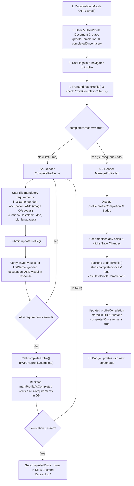

# Comprehensive Analysis of User Profile Completion Logic

> **Project:** FlatMate Marketplace  
> **Scope:** Analysis across `backend`, `frontend`, and `admin` codebases  
> **Target File:** `PROFILE_COMPLETION_ANALYSIS.md` (Project Root)  
> **Status:** Updated to reflect mandatory visual selection (`image` OR `avatar`) alongside `firstName`, `gender`, and `occupation` for `completedOnce`.

---

## 1. Executive Summary & Architecture Overview

Across the FlatMate Marketplace project, user profile data, onboarding status, and completion tracking are governed by a dual-model structure on the backend (`User` and `UserProfile`), a centralized Zustand authentication store on the frontend (`useAuthStore`), and administrative observability in the `admin` panel.

### Core Architectural Principles:
1. **Separation of Concerns: `completedOnce` vs. `profileCompletion`:**  
   The application maintains two separate, decoupled concepts of completion:
   - **`completedOnce` (Boolean Gatekeeper):** Tracks whether a user has finished basic onboarding. It requires **four mandatory criteria**:
     1. `firstName` ("Your Name")
     2. `gender` ("Your Gender")
     3. `occupation` ("Who You Are")
     4. **Visual Selection (`image` OR `avatar`)**: The user must either upload a custom profile image or select a preset avatar. Either option satisfies the visual requirement.
     Once set to `true`, `completedOnce` remains `true` and allows the user to access the platform and view/manage their profile without repeating onboarding.
   - **`profileCompletion` (Numeric Score 0–100%):** A completeness score calculated exclusively by the backend (`calculateProfileCompletion` in `profile.controller.ts`) across **8 evaluated profile fields** (each worth 12.5%). Satisfying the 4 mandatory criteria yields an initial **50%** completion score (`4 * 12.5% = 50%`). It measures how complete the profile is, but it does **not** gate user access or dictate `completedOnce`.

2. **Backend Enforcement of Basic Completion:**  
   The `PATCH /api/profile/complete` endpoint (handled by `markProfileAsCompleted`) verifies that:
   - `profile.firstName?.trim()` is non-empty.
   - `profile.gender` is a valid enum value.
   - `profile.occupation` is a valid enum value.
   - At least one valid visual exists: a saved custom `image.url` OR an active preset `avatar` reference in the database.
   If any requirement is missing or invalid, the backend returns HTTP 400 and preserves `completedOnce = false`. Standard update endpoints (`updateProfile` and `updateUserProfileByAdmin`) explicitly strip `completedOnce` (`delete req.body.completedOnce`) so routine edits can never manipulate this milestone flag.

3. **Frontend Complete Profile Onboarding Flow (`CompleteProfile.tsx`):**  
   - Validates the 4 mandatory requirements (`firstName`, `gender`, `occupation`, and `image` OR `avatar`).
   - Keeps all other fields (`lastName`, `dateOfBirth`, `languagesKnown`, `aboutMe`) completely optional.
   - Submits profile data through the existing API (`updateProfile`).
   - Verifies that the saved profile from the backend response contains valid persisted values for all 4 mandatory requirements.
   - Only upon successful verification, invokes `completeProfile()` (`PATCH /api/profile/complete`).

4. **Routine Profile Management (`ManageProfile.tsx`):**  
   - Normal profile updates in `ManageProfile.tsx` do **not** touch or reset `completedOnce`.
   - If `completedOnce` is already `true`, it remains `true`.
   - The UI displays the backend-calculated `{profileCompletion}% Complete` badge.

---

## 2. Backend Analysis

### 2.1 User Model (`backend/src/models/auth/user.model.ts`)

The `User` model represents authentication credentials, account state, and verification statuses.

| Field Name | Type | Required in Schema? | Default Value | Notes / Validation |
|---|---|---|---|---|
| `_id` | `Types.ObjectId` | System (Yes) | Auto-generated | Mongoose ObjectId |
| `email` | `String` | No (optional) | `undefined` | Unique, sparse, lowercase, trimmed |
| `mobile` | `String` | No (optional) | `undefined` | Unique, sparse, trimmed |
| `password` | `String` | No (optional) | `undefined` | Hidden by default (`select: false`), hashed |
| `role` | `String` | Yes (Enum) | `'user'` | Enum: `['user']`, indexed |
| `accountStatus` | `String` | Yes (Enum) | `'active'` | Enum: `['active', 'inactive']`, indexed |
| `emailVerified` | `Boolean` | Yes | `false` | Verification status |
| `mobileVerified` | `Boolean` | Yes | `false` | Verification status |
| `profileVerified` | `Boolean` | Yes | `false` | Admin verification badge |
| `verificationStatus` | `String` | Yes (Enum) | `'not_submitted'` | Enum: `['not_submitted', 'pending', 'approved', 'rejected']` |
| `lastLoginAt` | `Date` | No | `undefined` | Timestamp of last login |
| `lastActiveAt` | `Date` | No | `undefined` | Timestamp of last activity |
| `isOnline` | `Boolean` | Yes | `false` | Real-time presence flag |
| `isDeleted` | `Boolean` | Yes | `false` | Soft-delete flag, indexed |
| `deletedAt` | `Date` | No | `undefined` | Deletion timestamp |
| `deletedBy` | `Types.ObjectId` | No | `null` | Admin who performed deletion |
| `deactiveAt` | `Date` | No | `null` | Deactivation timestamp |
| `deactiveBy` | `Types.ObjectId` | No | `null` | Admin/User who deactivated account |
| `createdAt` | `Date` | Auto | Timestamp | Managed by Mongoose `timestamps: true` |
| `updatedAt` | `Date` | Auto | Timestamp | Managed by Mongoose `timestamps: true` |

> **Note on User Model:** Fields on the `User` model (such as `email`, `mobile`, `emailVerified`, etc.) do not contribute to `profileCompletion` or `completedOnce`.

---

### 2.2 User Profile Model (`backend/src/models/auth/userProfile.model.ts`)

The `UserProfile` model stores biographical, lifestyle, and visual data for an individual user.

| Field Name | Type | Required in Schema? | Default Value | Notes / Validation |
|---|---|---|---|---|
| `userId` | `Types.ObjectId` | **Yes** | None | References `User` model, unique, indexed |
| `firstName` | `String` | No | `undefined` | Trimmed string. **Mandatory for `completedOnce`** |
| `lastName` | `String` | No | `undefined` | Trimmed string. Optional |
| `dateOfBirth` | `Date` | No | `undefined` | Date object. Optional |
| `gender` | `String` | No | `undefined` | Enum: `['male', 'female', 'other', 'any']`. **Mandatory for `completedOnce`** |
| `occupation` | `String` | No | `undefined` | Enum: `['student', 'working_professional', 'self_employed', 'business_owner', 'freelancer', 'other']`. **Mandatory for `completedOnce`** |
| `languagesKnown` | `[String]` | No | `[]` | Array of trimmed strings. Optional |
| `aboutMe` | `String` | No | `undefined` | Trimmed string (bio). Optional |
| `image` | `Object` (`{ url?: string; key?: string }`) | No | `undefined` | S3 custom image. **Either `image` or `avatar` is mandatory for `completedOnce`** |
| `avatar` | `Types.ObjectId` | No | `undefined` | References `Avatar` model. **Either `image` or `avatar` is mandatory for `completedOnce`** |
| `preferences` | `[Types.ObjectId]` | No | `[]` | References `UserPreference` collection, indexed. Optional |
| `profileCompletion` | `Number` | Yes | `0` | Min: 0, Max: 100. System-calculated percentage |
| `completedOnce` | `Boolean` | Yes | `false` | Milestone flag marking basic profile onboarding completion |
| `createdAt` | `Date` | Auto | Timestamp | Managed by Mongoose `timestamps: true` |
| `updatedAt` | `Date` | Auto | Timestamp | Managed by Mongoose `timestamps: true` |

> **Schema vs. Onboarding Requirement:** `image` and `avatar` remain optional at the Mongoose schema level to allow partial saves during normal updates, but at least one must be provided and valid before `completedOnce` is marked `true`.

---

### 2.3 Validation Schemas (`backend/src/validations/auth/profile.validation.ts`)

The backend Zod schema used to validate profile updates is `updateProfileSchema`:

```typescript
export const updateProfileSchema = z.object({
  body: z.object({
    firstName: z.string().trim().min(1).optional(),
    lastName: z.string().trim().min(1).optional(),
    dateOfBirth: z.preprocess(preprocessDate, z.string().datetime().or(z.date()).nullable().optional()),
    gender: z.enum(['male', 'female', 'other', 'any']).optional(),
    occupation: z.string().optional(),
    languagesKnown: z.preprocess(preprocessJsonOrArray, z.array(z.string()).optional()),
    aboutMe: z.string().max(1000).optional(),
    image: z.preprocess(
      preprocessImage,
      z.object({
        url: z.string().url('Invalid image URL').optional(),
        key: z.string().optional(),
      }).nullable().optional()
    ),
    avatar: z.string().regex(/^[0-9a-fA-F]{24}$/, 'Invalid avatar ID').nullable().optional(),
    preferences: z.preprocess(
      preprocessJsonOrArray,
      z.array(z.string().regex(/^[0-9a-fA-F]{24}$/, 'Invalid preference ID')).optional()
    ),
  }),
});
```

#### Observations:
1. Every field in `updateProfileSchema` is marked `.optional()`. Users can update any subset of fields.
2. `completedOnce` is **not accepted** in the schema and is explicitly stripped in controllers.
3. `occupation` in Zod allows any string, while Mongoose enforces the schema enum.

---

### 2.4 Profile Completion Calculation (`profile.controller.ts`)

Located at: `backend/src/controllers/auth/profile.controller.ts` (lines 91–126).

```typescript
export const calculateProfileCompletion = (profile: Partial<IUserProfile>): number => {
  const fields = [
    'firstName',
    'lastName',
    'dateOfBirth',
    'gender',
    'occupation',
    'languagesKnown',
    'aboutMe',
    'image',
  ];

  let completedFields = 0;

  for (const field of fields) {
    let val = (profile as any)[field];
    if (field === 'image' && (!val || (typeof val === 'object' && Object.keys(val).length === 0))) {
      val = (profile as any)['avatar'];
    }
    if (val !== undefined && val !== null) {
      if (Array.isArray(val) && val.length > 0) {
        completedFields++;
      } else if (typeof val === 'object' && Object.keys(val).length > 0) {
        completedFields++;
      } else if (typeof val === 'string' && val.trim() !== '') {
        completedFields++;
      } else if (typeof val === 'number') {
        completedFields++;
      } else if (val instanceof Date) {
        completedFields++;
      }
    }
  }

  return Math.min(100, Math.round((completedFields / fields.length) * 100));
};
```

#### Breakdown of the Percentage Calculation:
- **Total Evaluated Fields:** `8` fields.
- **Weight per Field:** `100 / 8 = 12.5%`.
- **Rounding:** `Math.min(100, Math.round((completedFields / 8) * 100))`.
  - 1 field = 13%
  - 2 fields = 25%
  - 3 fields = 38%
  - 4 fields (minimum for basic onboarding completion: Name, Gender, Occupation, Visual) = **50%**
  - 5 fields = 63%
  - 6 fields = 75%
  - 7 fields = 88%
  - 8 fields = 100%
- **Image & Avatar Mutual Fallback:** The 8th slot checks `image`; if empty/null, it falls back to `avatar`. Either satisfies the visual slot (12.5%).
- **Excluded Fields:** `preferences`, `completedOnce`, and `User` model attributes do not contribute to `profileCompletion`.

---

### 2.5 Controller Logic & Endpoint Handlers

#### 1. Marking Profile as Completed Once (`PATCH /api/profile/complete` or `PATCH /api/users/profile/complete`):
Handler: `markProfileAsCompleted` in `profile.controller.ts`:
```typescript
export const markProfileAsCompleted = async (req: Request, res: Response): Promise<Response> => {
  try {
    if (!req.user) {
      return sendError(res, 'Authentication required', 401);
    }

    const profile = await UserProfile.findOne({ userId: req.user._id });
    if (!profile) {
      return sendError(res, 'User profile not found. Please save your profile details first.', 404);
    }

    // Mandatory profile completion verification: firstName, gender, occupation, and (image OR avatar)
    const hasFirstName = Boolean(profile.firstName && profile.firstName.trim().length > 0);
    const validGenders = ['male', 'female', 'other', 'any'];
    const hasGender = Boolean(profile.gender && validGenders.includes(profile.gender));
    const validOccupations = [
      'student',
      'working_professional',
      'self_employed',
      'business_owner',
      'freelancer',
      'other',
    ];
    const hasOccupation = Boolean(profile.occupation && validOccupations.includes(profile.occupation));

    const hasValidImage = Boolean(
      profile.image &&
      typeof profile.image.url === 'string' &&
      profile.image.url.trim().length > 0
    );

    let hasValidAvatar = false;
    if (profile.avatar) {
      const avatarId = (profile.avatar as any)?._id || profile.avatar;
      if (Types.ObjectId.isValid(String(avatarId))) {
        const avatarDoc = await Avatar.findOne({ _id: avatarId, isActive: true });
        if (avatarDoc) {
          hasValidAvatar = true;
        }
      }
    }

    const hasValidVisual = hasValidImage || hasValidAvatar;

    if (!hasFirstName || !hasGender || !hasOccupation || !hasValidVisual) {
      return sendError(
        res,
        'Cannot complete profile: firstName, gender, occupation, and either a valid profile image or avatar are required.',
        400
      );
    }

    profile.completedOnce = true;
    await profile.save();

    logger.info(`Profile marked as completed for user: ${req.user._id}`);
    return sendSuccess(res, 'Profile marked as completed successfully', {
      completedOnce: true,
    });
  } catch (error) {
    logger.error('[ProfileController] Failed to mark profile as completed:', error);
    return sendError(res, 'Failed to mark profile as completed', 500);
  }
};
```
- **Strict Verification:** Rejects with HTTP 400 if `firstName`, `gender`, `occupation`, or visual (`image` OR `avatar`) are missing, empty, or invalid.
- **Preset Avatar Validation:** Verifies the referenced avatar exists and has `isActive: true` in the `Avatar` collection.
- **Safety:** Does not create an empty profile or bypass validation.

#### 2. Standard Profile Updates (`PATCH /api/profile`):
Handler: `updateProfile` in `profile.controller.ts`:
```typescript
// Prevent modifying core system fields
delete req.body.userId;
delete req.body.profileCompletion;
delete req.body._id;
delete req.body.completedOnce;
```
- Deleting `completedOnce` prevents clients from tampering with `completedOnce` via standard profile updates.
- Normal profile edits in `ManageProfile` update fields, recalculate `profileCompletion`, and preserve whatever value `completedOnce` currently holds.

#### 3. Admin Profile Updates (`PUT /api/users/:userId/profile`):
Handler: `updateUserProfileByAdmin` in `user.controller.ts`:
```typescript
// Prevent modifying system fields
delete req.body.userId;
delete req.body.profileCompletion;
delete req.body._id;
delete req.body.completedOnce;
```
- Admin updates also strip `completedOnce`, ensuring administrative edits to user profile fields recalculate `profileCompletion` without altering `completedOnce`.

---

## 3. Frontend Analysis

### 3.1 Zustand Store (`frontend/src/store/useAuthStore.ts`)

#### Key Actions:
- `checkProfileCompletionStatus()`: Calls `GET /api/profile/completion-status`, updates `profile.completedOnce` in state, and returns boolean.
- `completeProfile()`: Calls `PATCH /api/profile/complete`. On success, updates `profile.completedOnce = true`. On error, captures backend error message in `profileError` and returns `false`.
- `updateProfile(data)`: Sends `PATCH /api/profile` with FormData or JSON payload. Updates `profile` with the returned document (including recalculated `profileCompletion`).

---

### 3.2 Page & Component Structure

```
frontend/src/app/(dashboard)/profile/page.tsx
   └── <MyProfile /> (frontend/src/components/dashboard/profile/MyProfile.tsx)
          ├── If completedOnce === false:  <CompleteProfile />
          └── If completedOnce === true:   <ManageProfile />
```

- When visiting `/profile`:
  - `MyProfile.tsx` checks `completedOnce`.
  - If `false`, it renders `<CompleteProfile />`.
  - If `true`, it renders `<ManageProfile />`.

---

### 3.3 Basic Profile Completion: `CompleteProfile.tsx`

Located at: `frontend/src/components/dashboard/profile/CompleteProfile.tsx`.

#### Mandatory Requirements:
1. `firstName` ("Your Name")
2. `gender` ("Your Gender")
3. `occupation` ("Who You Are")
4. **Visual (`image` OR `avatar`)**: User must select a preset avatar OR upload a custom profile image. Either satisfies the visual requirement.

#### Optional Fields:
All other fields are explicitly optional in the UI and submission:
- `lastName` (Last Name) — optional
- `dateOfBirth` (Date of Birth) — optional
- `languagesKnown` (Languages You Speak: English, Hindi, Marathi, Other) — optional
- `aboutMe` (Introduce Yourself) — optional

#### Execution Flow (`handleSubmitProfile`):
1. **Frontend Validation:**
   ```typescript
   if (!firstName.trim()) {
     setStatusMessage({ type: "error", text: "First name is required." });
     return;
   }
   if (!gender) {
     setStatusMessage({ type: "error", text: "Please select your gender." });
     return;
   }
   if (!occupation) {
     setStatusMessage({ type: "error", text: "Please select your occupation (Who You Are)." });
     return;
   }

   const hasVisualSelected = Boolean(
     selectedFile ||
     selectedAvatarId ||
     (!isImageRemoved && (previewUrl || profile?.image?.url || profile?.avatar))
   );

   if (!hasVisualSelected || !previewUrl) {
     setStatusMessage({
       type: "error",
       text: "Please upload a profile image or select a preset avatar.",
     });
     return;
   }
   ```
2. **Profile Submission:** Calls `updateProfile(payload | formData)` with only provided fields.
3. **Save Wait & Post-Save Verification:**
   ```typescript
   if (!updateSuccess) {
     setStatusMessage({ type: "error", text: storeError || "Failed to save profile information." });
     setIsSaving(false);
     return;
   }

   const savedProfile = useAuthStore.getState().profile;
   const hasValidFirstName = Boolean(savedProfile?.firstName && savedProfile.firstName.trim().length > 0);
   const hasValidGender = Boolean(savedProfile?.gender && savedProfile.gender.trim().length > 0);
   const hasValidOccupation = Boolean(savedProfile?.occupation && savedProfile.occupation.trim().length > 0);

   const hasValidImage = Boolean(
     savedProfile?.image?.url &&
     typeof savedProfile.image.url === "string" &&
     savedProfile.image.url.trim().length > 0
   );

   const hasValidAvatar = Boolean(
     savedProfile?.avatar &&
     (typeof savedProfile.avatar === "string"
       ? savedProfile.avatar.trim().length > 0
       : Boolean((savedProfile.avatar as any)?._id))
   );

   const hasValidVisual = hasValidImage || hasValidAvatar;

   if (!hasValidFirstName || !hasValidGender || !hasValidOccupation || !hasValidVisual) {
     setStatusMessage({
       type: "error",
       text: !hasValidVisual
         ? "Profile verification failed: Please upload a profile image or select a preset avatar."
         : "Profile verification failed: Name, Gender, Occupation, and Image/Avatar must be saved before completing profile.",
     });
     setIsSaving(false);
     return;
   }
   ```
4. **Mark As Completed:** Only after successful verification, calls `await completeProfile()`.
5. **UI Transition:** Redirects the user to `/` upon success.

---

### 3.4 Profile Management: `ManageProfile.tsx`

Located at: `frontend/src/components/dashboard/profile/ManageProfile.tsx`.

- **Independence from `completedOnce`:** Editing fields in `ManageProfile.tsx` only calls `updateProfile(payload)`. Because `completedOnce` is stripped by the backend, ordinary edits never toggle or manipulate `completedOnce`.
- **Completion Percentage Display:**
  ```tsx
  const completionPercentage = profile?.profileCompletion ?? 0;
  
  <span className="text-base sm:text-lg font-bold text-[#0066F9]">
    {completionPercentage}% Complete
  </span>
  ```
  Reflects the backend-calculated completion (0–100%).

---

## 4. Admin Analysis

Admin files located in `admin/` were inspected:
- `admin/lib/api.ts`
- `admin/components/my/user/profile/UsersManager.tsx`
- `admin/components/my/user/profile/UserDetailsDrawer.tsx`
- `admin/components/my/user/profile/EditUserProfileDialog.tsx`

### Admin Capabilities:
1. **View User Profiles:** Admins fetch user profiles via `GET /api/users/:userId/profile`. The table and drawer display `profileCompletion`.
2. **Edit User Profiles:** Admins edit biographical details via `PUT /api/users/:userId/profile`.
3. **Backend Stripping:** `updateUserProfileByAdmin` strips `delete req.body.completedOnce;`, ensuring admin edits cannot inadvertently alter `completedOnce`.
4. **Completion Recalculation:** Admin edits invoke `calculateProfileCompletion` so the completion percentage reflects current data accurately.

---

## 5. Profile Completion Fields & Weights Matrix

| Field / Section | Model | Required in Backend? | Frontend Validation? | Included in `completedOnce`? | Included in `profileCompletion`? | Completion Weight / Value | Default Value | Notes |
|---|---|---|---|---|---|---|---|---|
| `firstName` | `UserProfile` | Optional in Schema; Zod `.min(1).optional()` | **Mandatory** in `CompleteProfile`; Required in `ManageProfile` | **Yes (Mandatory)** | **Yes** | **12.5%** | `undefined` | Trimmed string. "Your Name". |
| `gender` | `UserProfile` | Optional in Schema; Zod enum optional | **Mandatory** in `CompleteProfile`; Optional in `ManageProfile` | **Yes (Mandatory)** | **Yes** | **12.5%** | `undefined` | Enum: `'male'`, `'female'`, `'other'`, `'any'`. "Your Gender". |
| `occupation` | `UserProfile` | Optional in Schema; Zod string optional | **Mandatory** in `CompleteProfile`; Optional in `ManageProfile` | **Yes (Mandatory)** | **Yes** | **12.5%** | `undefined` | Schema Enum. "Who You Are". |
| `image` | `UserProfile` | Optional in Schema; Zod object optional | **Mandatory (Either image OR avatar)** | **Yes (Either/Or)** | **Yes** (shares slot with `avatar`) | **12.5%** | `undefined` | S3 custom image `{ url, key }`. Mutually exclusive with `avatar`. |
| `avatar` | `UserProfile` | Optional in Schema; Zod ObjectId optional | **Mandatory (Either image OR avatar)** | **Yes (Either/Or)** | **Yes** (fallback slot for `image`) | **12.5%** | `undefined` | References `Avatar` model. Mutually exclusive with `image`. |
| `lastName` | `UserProfile` | Optional in Schema; Zod `.min(1).optional()` | **Optional** in `CompleteProfile`; Optional in `ManageProfile` | **No** | **Yes** | **12.5%** | `undefined` | Trimmed string. |
| `dateOfBirth` | `UserProfile` | Optional in Schema; Zod nullable optional | **Optional** in `CompleteProfile`; Optional in `ManageProfile` | **No** | **Yes** | **12.5%** | `undefined` | Evaluated as date/string. |
| `languagesKnown` | `UserProfile` | Optional in Schema; Zod array optional | **Optional** in `CompleteProfile`; Optional in `ManageProfile` | **No** | **Yes** | **12.5%** | `[]` | Evaluated as non-empty array. Options: English, Hindi, Marathi, Other. |
| `aboutMe` | `UserProfile` | Optional in Schema; Zod max 1000 optional | **Optional** in `CompleteProfile`; Optional in `ManageProfile` | **No** | **Yes** | **12.5%** | `undefined` | Evaluated as non-empty string. |
| `preferences` | `UserProfile` | Optional in Schema; Zod ObjectId array optional | Optional in forms | **No** | **No** | *Not explicitly defined* (0%) | `[]` | User preferences array. |
| `completedOnce` | `UserProfile` | Set via `PATCH /profile/complete` | Managed via `completeProfile()` | Milestone Output | **No** | *Not explicitly defined* (0%) | `false` | Gatekeeper flag that switches UI from `CompleteProfile` to `ManageProfile`. |
| `profileCompletion` | `UserProfile` | System calculated (0–100) | Read-only in UI and admin | **No** | Calculated Output | **N/A** (Score result) | `0` | Computed as `Math.min(100, Math.round((completedFields / 8) * 100))`. |
| `userId` | `UserProfile` | **Yes** (Schema) | System-managed | **No** | **No** | *Not explicitly defined* (0%) | Assigned at creation | References parent `User`. |
| `email` | `User` | Optional in Schema | Displayed read-only | **No** | **No** | *Not explicitly defined* (0%) | `undefined` | Belongs to `User`. |
| `mobile` | `User` | Optional in Schema | Displayed read-only | **No** | **No** | *Not explicitly defined* (0%) | `undefined` | Belongs to `User`. |
| `role` | `User` | Yes in Schema (`'user'`) | System-managed | **No** | **No** | *Not explicitly defined* (0%) | `'user'` | Role. |
| `accountStatus` | `User` | Yes in Schema (`'active' \| 'inactive'`) | Managed by Admin | **No** | **No** | *Not explicitly defined* (0%) | `'active'` | Account status. |

---

## 6. Complete Data Flow



---

## 7. Key Guardrails & Constraints Implemented

1. **Mandatory Visual for Basic Completion:**  
   `markProfileAsCompleted` in `profile.controller.ts` requires at least one valid profile visual: either a custom image with non-empty URL or a valid, active preset avatar in the `Avatar` collection. If neither exists, the request returns HTTP 400 and `completedOnce` remains `false`.

2. **Frontend Post-Save Verification:**  
   `CompleteProfile.tsx` saves data via `updateProfile`, checks the returned store state to verify that `firstName`, `gender`, `occupation`, and either `image` or `avatar` were successfully persisted, and only then calls `completeProfile()`.

3. **No Automatic `completedOnce` in Standard Updates:**  
   `updateProfile` in `profile.controller.ts` and `updateUserProfileByAdmin` in `user.controller.ts` execute `delete req.body.completedOnce`. Regular profile updates in `ManageProfile` or by administrators cannot toggle `completedOnce`.

4. **Decoupled `profileCompletion` Percentage:**  
   The 8-field percentage formula remains intact and separate. Completing the 4 mandatory requirements yields an initial 50% completion (`4 / 8 = 50%`), while setting `completedOnce = true` to allow access. Users can fill in the remaining optional fields (`lastName`, `dateOfBirth`, `languagesKnown`, `aboutMe`) later in `ManageProfile` to reach 100%.
