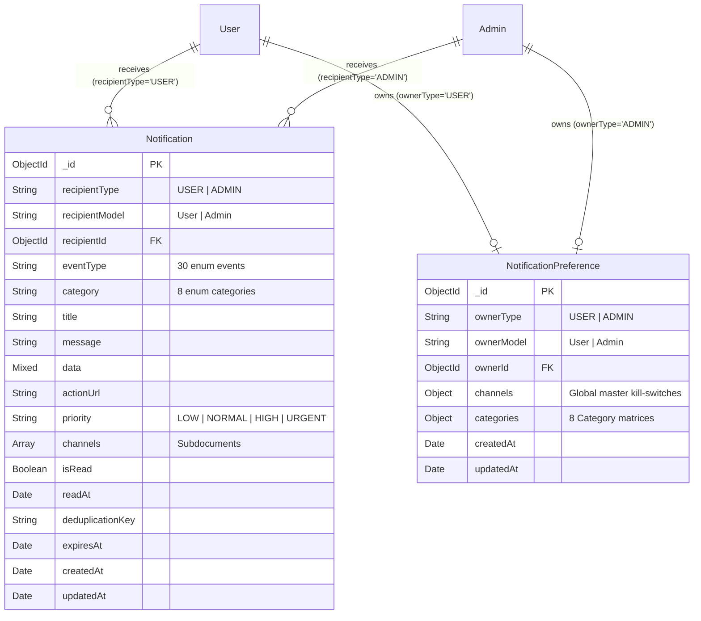
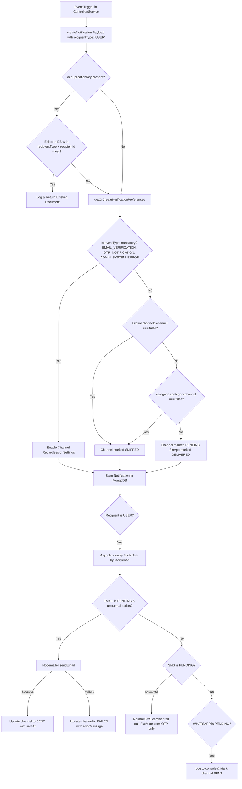
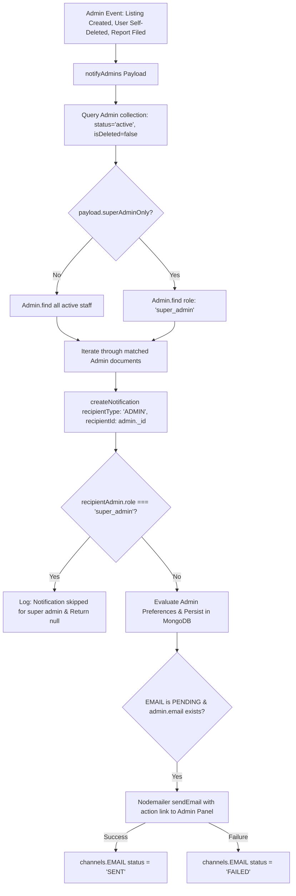
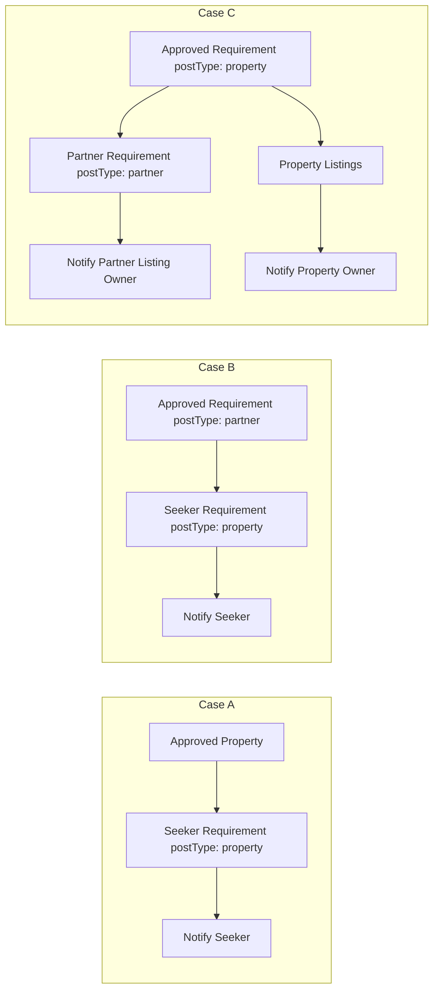
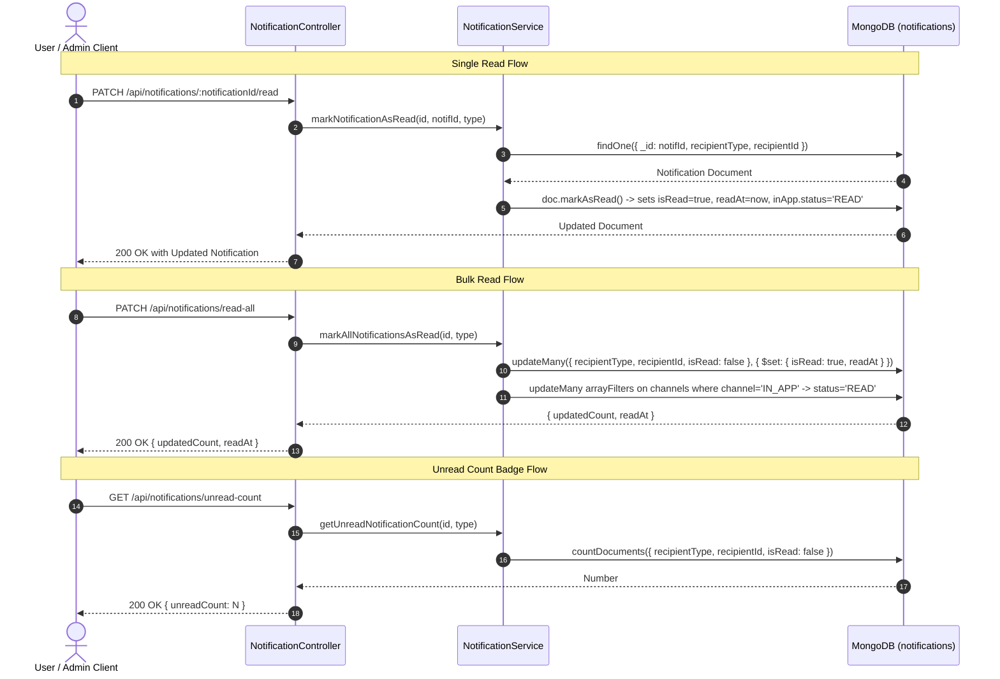

# FlatMate Notification System & Property Matching Documentation

> **Status:** Current & Source-Verified (v3.1)  
> **Target Audience:** Backend Developers, Frontend Engineers, Fullstack Integrators, System Architects  
> **Scope:** Complete Notification Architecture across Backend, Frontend, and Admin Panel, including Property-Matching Logic.

---

## Table of Contents

1. [Notification System Overview](#1-notification-system-overview)
2. [Project Architecture and Folder Structure](#2-project-architecture-and-folder-structure)
3. [Database Models and Relationships](#3-database-models-and-relationships)
4. [User Notification Flow](#4-user-notification-flow)
5. [Admin Notification Flow](#5-admin-notification-flow)
6. [Admin Roles and Recipient Selection](#6-admin-roles-and-recipient-selection)
7. [Notification Creation Triggers](#7-notification-creation-triggers)
8. [Notification Types and Categories](#8-notification-types-and-categories)
9. [Property Matching Logic](#9-property-matching-logic)
10. [Cron Jobs and Background Processing](#10-cron-jobs-and-background-processing)
11. [Notification Read/Unread Flow](#11-notification-readunread-flow)
12. [Notification APIs](#12-notification-apis)
13. [Backend Implementation Details](#13-backend-implementation-details)
14. [Frontend Integration and UI Flow](#14-frontend-integration-and-ui-flow)
15. [Duplicate Prevention and Error Handling](#15-duplicate-prevention-and-error-handling)
16. [Current Limitations and Important Observations](#16-current-limitations-and-important-observations)
17. [Future Extension Points](#17-future-extension-points)

---

## 1. Notification System Overview

The FlatMate Notification System is a unified, multi-channel messaging engine designed to alert regular marketplace users and staff administrators about critical platform events, listing moderation updates, safety reports, direct inquiries, and automated property/flatmate matches.

### Key Architectural Tenets
1. **Polymorphic Recipient Model**: Notifications are delivered either to regular users (`recipientType: 'USER'`) referencing the `User` collection or to platform staff (`recipientType: 'ADMIN'`) referencing the `Admin` collection via Mongoose `refPath`.
2. **Multi-Channel Tracking**: Every notification tracks independent delivery records across four distinct channels:
   - **`IN_APP`**: Real-time persisted inbox notification stored in MongoDB and displayed on the web dashboard.
   - **`EMAIL`**: Asynchronous HTML email dispatched via Nodemailer SMTP.
   - **`SMS`**: Text message delivery channel. In the current implementation, general notification SMS is intentionally commented out (`FlatMate uses OTP only` via MSG91 for security and authentication).
   - **`WHATSAPP`**: Direct messaging channel. Currently implemented as an internal logging queue stub.
3. **Two-Tier Preference Hierarchy**: Notifications respect user and staff opt-outs through a global channel master kill-switch and a granular category-level channel matrix. Mandatory security/transactional events bypass category opt-outs.
4. **Automated Event-Driven Property Matching**: When a property or flatmate requirement listing transitions to `approved`, the system executes an asynchronous, non-blocking matching engine that finds compatible seekers, flatmates, or property owners and alerts them with deep links.
5. **Deterministic Deduplication**: Cross-directional matching notifications and repeated system alerts are deduplicated at both the database index level and in application service queries.

---

## 2. Project Architecture and Folder Structure

The notification subsystem spans the backend API, the main user-facing frontend dashboard, and the staff administration portal:

```
d:/MyWork/Buzzlink/flatmate/
├── backend/
│   └── src/
│       ├── models/
│       │   ├── auth/
│       │   │   ├── user.model.ts                    # User model (recipient for USER notifications)
│       │   │   └── admin.model.ts                   # Admin model (recipient for ADMIN notifications)
│       │   ├── listing/
│       │   │   ├── property.model.ts                # Physical real estate property listings
│       │   │   ├── flatmateRequirements.model.ts    # Flatmate requirement listings (partner & property postTypes)
│       │   │   └── location.model.ts                # Geographic coordinates & structured address data
│       │   └── notification/
│       │       ├── notification.types.ts            # Enums, types, priority levels, categories, 30-event catalogue
│       │       ├── notification.model.ts            # Notification Mongoose schema, methods, compound & TTL indexes
│       │       └── notificationPreference.model.ts  # NotificationPreference Mongoose schema & isChannelEnabled()
│       ├── controllers/
│       │   ├── auth/
│       │   │   ├── mobileAuth.controller.ts         # User welcome & admin alerts on registration
│       │   │   └── user.controller.ts               # Account deletion alerts to admins
│       │   ├── listing/
│       │   │   ├── property.controller.ts           # Property submission, moderation approval/rejection triggers
│       │   │   ├── flatmateRequirements.controller.ts # Requirement submission, approval/rejection triggers
│       │   │   └── report.controller.ts             # Listing report submission alerts
│       │   └── notification/
│       │       └── notification.controller.ts       # Feed, unread count, read-all, single read, delete, preferences
│       ├── routes/
│       │   └── notification/
│       │       └── notification.routes.ts           # Express routes mounted at /api/notifications
│       ├── services/
│       │   ├── notification/
│       │   │   └── notification.service.ts          # Core engine: createNotification(), notifyAdmins(), feed queries
│       │   ├── listing/
│       │   │   └── propertyMatch.service.ts         # Automated compatibility engine & match notifications
│       │   ├── deletion/
│       │   │   ├── userDeletion.service.ts          # Cascading deletion of user notifications & preferences
│       │   │   └── adminDeletion.service.ts         # Cascading deletion of admin notifications & preferences
│       │   ├── dashboard/
│       │   │   └── dashboard.service.ts             # Aggregates user unread count & recent notifications
│       │   └── email/
│       │       └── email.service.ts                 # Nodemailer SMTP transporter & HTML email dispatcher
│       └── validations/
│           └── notification/
│               └── notification.validation.ts       # Zod schemas for pagination, preferences, read, and creation
│
├── frontend/
│   └── src/
│       ├── app/(dashboard)/notifications/
│       │   └── page.tsx                             # User dashboard notification route (/notifications)
│       ├── components/
│       │   ├── dashboard/notification/
│       │   │   ├── NotificationsManager.tsx         # Dashboard container with tab view state (inbox vs channels)
│       │   │   ├── NotificationList.tsx             # Paginated feed, category filtering, unread pill, mark-all-read
│       │   │   ├── NotificationItem.tsx             # Alert card with category icons, unread indicator, action links
│       │   │   ├── NotificationPreferences.tsx      # Master channel toggles & per-category delivery matrix
│       │   │   ├── NotificationBell.tsx             # Navbar bell component with real-time unread badge counter
│       │   │   └── DeleteNotificationDialog.tsx     # Confirmation dialog for deleting an alert
│       │   └── layout/
│       │       └── Navbar.tsx                       # Mounts NotificationBell in the authenticated navigation bar
│       ├── services/
│       │   └── notification.service.ts              # Axios client wrappers for /api/notifications endpoints
│       ├── store/
│       │   └── useNotificationStore.ts              # Zustand global state store for notifications & preferences
│       └── types/
│           └── notification.types.ts                # TypeScript interfaces, enums, category UI styling metadata
│
└── admin/
    ├── app/
    │   ├── admin/notifications/page.tsx             # Staff Admin notifications page route (/admin/notifications)
    │   └── super-admin/notifications/page.tsx       # Super Admin notifications page route (/super-admin/notifications)
    ├── components/
    │   ├── topbar.tsx                               # Admin Topbar with notification bell popover & badge
    │   └── my/notification/
    │       ├── AdminNotificationsManager.tsx        # Admin container component managing active views
    │       ├── AdminNotificationList.tsx            # Admin notification feed, priority filters, & bulk actions
    │       ├── AdminNotificationItem.tsx            # Admin alert card with priority tag & deep links
    │       ├── AdminNotificationPreferences.tsx     # Admin delivery channel & category toggles
    │       └── DeleteNotificationDialog.tsx         # Admin delete confirmation dialog
    ├── lib/
    │   └── api.ts                                   # Admin fetch API client for notification endpoints
    └── types/
        └── notification.types.ts                    # Admin TypeScript interfaces & category metadata
```

---

## 3. Database Models and Relationships

The notification system utilizes two collections in MongoDB: `notifications` and `notificationpreferences`.

### 3.1 Entity Relationship Diagram



### 3.2 `Notification` Schema (`notifications` collection)
Defined in `backend/src/models/notification/notification.model.ts`:

| Field | Type | Validation & Defaults | Description |
|---|---|---|---|
| `recipientType` | `String` | Enum: `['USER', 'ADMIN']`, Required, Index | Target audience discriminator |
| `recipientModel` | `String` | Enum: `['User', 'Admin']`, auto-derived in pre-validate | Dynamic Mongoose `refPath` target |
| `recipientId` | `ObjectId` | Required, `refPath: 'recipientModel'`, Index | Recipient document ID in User or Admin collection |
| `eventType` | `String` | Enum: `NOTIFICATION_EVENT_TYPES`, Required, Index | Granular business event key (e.g. `LISTING_APPROVED`) |
| `category` | `String` | Enum: `NOTIFICATION_CATEGORIES`, Required, Index | Broad grouping (derived from `EVENT_CATEGORY_MAP`) |
| `title` | `String` | Required, Trim, Max length: 250 | Notification headline |
| `message` | `String` | Required, Trim, Max length: 2000 | Body text |
| `data` | `Mixed` | Default: `{}` | Contextual payload (listing IDs, slugs, metadata) |
| `actionUrl` | `String` | Optional, Trim | Destination client route (e.g. `/listing/flat-bandra`) |
| `priority` | `String` | Enum: `['LOW', 'NORMAL', 'HIGH', 'URGENT']`, Default: `'NORMAL'` | Priority rating |
| `channels` | `[ChannelDeliverySchema]` | Subdocument array | Per-channel delivery status and attempt tracking |
| `isRead` | `Boolean` | Default: `false`, Index | In-app read status |
| `readAt` | `Date` | Default: `null` | Timestamp when notification was marked read |
| `deduplicationKey`| `String` | Optional, Trim | Unique identifier preventing duplicate alerts |
| `expiresAt` | `Date` | Default: `null` | Timestamp for automatic MongoDB TTL document eviction |
| `createdAt` / `updatedAt` | `Date` | Mongoose timestamps | Auto-generated document timestamps |

#### `channels` Subdocument Fields:
- `channel`: `'IN_APP' | 'EMAIL' | 'SMS' | 'WHATSAPP'` (Required)
- `status`: `'PENDING' | 'PROCESSING' | 'SENT' | 'DELIVERED' | 'READ' | 'FAILED' | 'SKIPPED'` (Default: `'PENDING'`)
- `attemptCount`: `Number` (Default: `0`)
- `providerMessageId`: `String` (Optional)
- `lastAttemptAt`: `Date` (Optional)
- `sentAt`: `Date` (Optional)
- `deliveredAt`: `Date` (Optional)
- `readAt`: `Date` (Optional)
- `errorMessage`: `String` (Optional)
- `providerMetadata`: `Mixed` (Optional)

#### Database Indexes on `notifications`:
1. `{ recipientType: 1, recipientId: 1, createdAt: -1 }`: Feed retrieval and sorting.
2. `{ recipientType: 1, recipientId: 1, isRead: 1, createdAt: -1 }`: Unread count and unread-only feed filtering.
3. `{ recipientType: 1, recipientId: 1, category: 1, createdAt: -1 }`: Category-filtered queries.
4. `{ recipientType: 1, recipientId: 1, eventType: 1, createdAt: -1 }`: Specific event-based queries.
5. `{ recipientType: 1, recipientId: 1, deduplicationKey: 1 }` (`unique: true, partialFilterExpression: { deduplicationKey: { $type: 'string' } }`): Enforces uniqueness scoped to recipient while ignoring documents where `deduplicationKey` is null or missing.
6. `{ expiresAt: 1 }` (`expireAfterSeconds: 0, sparse: true`): MongoDB native TTL index for automatic deletion of expired notifications.
7. `{ 'channels.channel': 1, 'channels.status': 1 }`: Channel delivery lookups.

### 3.3 `NotificationPreference` Schema (`notificationpreferences` collection)
Defined in `backend/src/models/notification/notificationPreference.model.ts`:

| Field | Type | Validation & Defaults | Description |
|---|---|---|---|
| `ownerType` | `String` | Enum: `['USER', 'ADMIN']`, Required, Index | Preference owner discriminator |
| `ownerModel` | `String` | Enum: `['User', 'Admin']`, auto-derived | Dynamic Mongoose `refPath` target |
| `ownerId` | `ObjectId` | Required, `refPath: 'ownerModel'`, Index | Document ID in User or Admin collection |
| `channels` | `Object` | Schema: `channelPreferencesSchema` | Global master toggles: `{ inApp, email, sms, whatsapp }` |
| `categories` | `Object` | Subdocuments for 8 categories | Per-category channel matrices |

#### Database Indexes on `notificationpreferences`:
1. `{ ownerType: 1, ownerId: 1 }` (`unique: true`): Strictly one preference document per user or administrator.
2. Automatic cleanup: Drops legacy `user_1` index via connection event if it lingered from pre-polymorphic schemas.

---

## 4. User Notification Flow

When an event triggers a notification for a regular user:



---

## 5. Admin Notification Flow

Staff alerts keep platform moderators informed about new registrations, pending moderation queues, and safety reports:



---

## 6. Admin Roles and Recipient Selection

The platform operates two distinct administrative roles:

1. **Staff Admin (`role === 'admin'`)**:
   - The primary operational audience for platform notifications.
   - Receives moderation queues (`ADMIN_LISTING_AWAITING_MODERATION`), safety reports (`ADMIN_REPORT_SUBMITTED`), user registrations (`ADMIN_NEW_USER_REGISTERED`), and account self-deletions (`ADMIN_USER_DELETED`).
   - Receives in-app notifications and email alerts with direct links into the admin panel (`/admin/...`).

2. **Super Admin (`role === 'super_admin'`)**:
   - **Notification Suppression by Design**: In `backend/src/services/notification/notification.service.ts` (lines 148-160), `createNotification()` explicitly intercepts any admin recipient where `role === 'super_admin'` and returns `null` immediately:
     ```typescript
     if (recipientType === 'ADMIN') {
       const recipientAdmin = await Admin.findById(recipientId).select('role').lean();
       if (recipientAdmin?.role === 'super_admin') {
         logger.info(`[Notification Service] Notification skipped for super admin ${recipientId}`);
         return null;
       }
     }
     ```
   - **Default Preferences**: When super admin preferences are initialized via `getOrCreateNotificationPreferences()`, all global channels and categories are initialized to `false` (`DEFAULT_SUPER_ADMIN_CHANNEL_PREFERENCES` & `DEFAULT_SUPER_ADMIN_CATEGORY_PREFERENCES`).
   - **Architectural Note on `notifyAdmins({ superAdminOnly: true })`**: Even though `notifyAdmins()` supports a `superAdminOnly: true` query flag, any subsequent call into `createNotification()` evaluates the recipient role and drops the notification. Therefore, super administrators currently do not receive notifications.

---

## 7. Notification Creation Triggers

The following table documents every active and inactive notification trigger in the source code:

| Event Type | Trigger File | Function / Endpoint | Recipient | Status in Code | Description |
|---|---|---|---|---|---|
| `USER_REGISTERED` | `controllers/auth/mobileAuth.controller.ts` | `registerWithMobileOTP` | `USER` (`user._id`) | **Active** | Welcome alert sent to user on mobile OTP registration |
| `ADMIN_NEW_USER_REGISTERED` | `controllers/auth/mobileAuth.controller.ts` | `registerWithMobileOTP` | `ADMIN` (`notifyAdmins`) | **Active** | Broadcast to active staff admins on new user registration |
| `ADMIN_USER_DELETED` | `controllers/auth/user.controller.ts` | `softDeleteUserSelf` | `ADMIN` (`notifyAdmins`) | **Active** | Broadcast to staff admins when user self-deletes account |
| `LISTING_SUBMITTED` | `controllers/listing/property.controller.ts` | `createProperty` | `USER` (`property.userId`) | **Active** | Submission confirmation for property under review |
| `LISTING_SUBMITTED` | `controllers/listing/flatmateRequirements.controller.ts` | `createFlatmateRequirement` | `USER` (`requirement.userId`) | **Active** | Submission confirmation for flatmate requirement |
| `ADMIN_LISTING_AWAITING_MODERATION` | `controllers/listing/property.controller.ts` | `createProperty`, `updateProperty` | `ADMIN` (`notifyAdmins`) | **Active** | Staff alert when property requires moderation |
| `ADMIN_LISTING_AWAITING_MODERATION` | `controllers/listing/flatmateRequirements.controller.ts` | `createFlatmateRequirement`, `updateFlatmateRequirement` | `ADMIN` (`notifyAdmins`) | **Active** | Staff alert when requirement requires moderation |
| `LISTING_APPROVED` | `controllers/listing/property.controller.ts` | `createProperty` (auto-approved), `updateProperty`, `updatePropertyStatus`, `bulkUpdatePropertyStatus` | `USER` (`property.userId`) | **Active** | Notice to property owner that listing is approved |
| `LISTING_APPROVED` | `controllers/listing/flatmateRequirements.controller.ts` | `createFlatmateRequirement` (auto-approved), `updateFlatmateRequirement`, `updateFlatmateRequirementStatus`, `bulkUpdateRequirementStatus` | `USER` (`requirement.userId`) | **Active** | Notice to requirement owner that listing is approved |
| `LISTING_REJECTED` | `controllers/listing/property.controller.ts` | `updateProperty`, `updatePropertyStatus`, `bulkUpdatePropertyStatus` | `USER` (`property.userId`) | **Active** | Rejection notice with admin feedback reason |
| `LISTING_REJECTED` | `controllers/listing/flatmateRequirements.controller.ts` | `updateFlatmateRequirement`, `updateFlatmateRequirementStatus`, `bulkUpdateRequirementStatus` | `USER` (`requirement.userId`) | **Active** | Rejection notice with admin feedback reason |
| `LISTING_UNPUBLISHED` | `controllers/listing/property.controller.ts` | `updateProperty`, `updatePropertyStatus`, `bulkUpdatePropertyStatus` | `USER` (`property.userId`) | **Active** | Notice when listing is closed or blocked |
| `LISTING_UNPUBLISHED` | `controllers/listing/flatmateRequirements.controller.ts` | `updateFlatmateRequirement`, `updateFlatmateRequirementStatus`, `bulkUpdateRequirementStatus` | `USER` (`requirement.userId`) | **Active** | Notice when requirement is closed or blocked |
| `ADMIN_REPORT_SUBMITTED` | `controllers/listing/report.controller.ts` | `createReport` | `ADMIN` (`notifyAdmins`) | **Active** | Alert to staff when user reports a listing |
| `REPORT_SUBMITTED_CONFIRMATION` | `controllers/listing/report.controller.ts` | `createReport` | `USER` (`userId`) | **Active** | Confirmation to the user who filed the report |
| `PROPERTY_MATCH_FOUND` | `services/listing/propertyMatch.service.ts` | `processListingMatches` | `USER` (Matched owners) | **Active** | Automated alerts on compatible listing approval |
| `USER_REGISTERED` | `controllers/auth/user.controller.ts` | `registerUser` | `USER` | **Commented Out** | Email/password registration notifications commented out |
| `ADMIN_NEW_USER_REGISTERED` | `controllers/auth/user.controller.ts` | `registerUser` | `ADMIN` | **Commented Out** | Email/password admin registration alert commented out |
| `REPORT_STATUS_UPDATED` | `controllers/listing/report.controller.ts` | `updateReportStatus` | `USER` (`report.userId`) | **Commented Out** | Lines 611-627 commented out in source |
| `NEW_CHAT_MESSAGE` | Catalogue defined | N/A | `USER` | **Catalogue Only** | Handled via real-time WebSocket chat service |
| `EMAIL_VERIFICATION` | Catalogue defined | N/A | `USER` | **Catalogue Only** | Handled via dedicated auth email token controller |
| `OTP_NOTIFICATION` | Catalogue defined | N/A | `USER` | **Catalogue Only** | Handled via dedicated MSG91 OTP service |
| All remaining events | Catalogue defined | N/A | Various | **Catalogue Only** | Registered in enums and category maps |

---

## 8. Notification Types and Categories

### 8.1 The 8 Core Categories
Defined in `NotificationCategory`:
1. **`ACCOUNT_AND_VERIFICATION`**: Security, verification tokens, password alerts, welcome messages.
2. **`LISTING_UPDATES`**: Listing approval, submission, rejection, expiration, and status changes.
3. **`PROPERTY_MATCH`**: Match notifications generated by the automated property matching engine.
4. **`CHAT`**: Communication between prospective tenants and landlords/flatmates.
5. **`INQUIRIES_AND_REQUESTS`**: Contact reveal requests, tenant leads, support inquiries.
6. **`REPORTS_AND_REVIEWS`**: Safety reports, violations, review approvals/rejections.
7. **`ADMINISTRATIVE`**: Staff notices regarding moderation queues and registrations.
8. **`SYSTEM`**: System health alerts, storage warnings, and infrastructure exceptions.

### 8.2 The 30-Event Catalogue & Category Mapping
Defined in `EVENT_CATEGORY_MAP` (`notification.types.ts`):

```typescript
export const EVENT_CATEGORY_MAP: Record<NotificationEventType, NotificationCategory> = {
  USER_REGISTERED:                      'ACCOUNT_AND_VERIFICATION',
  EMAIL_VERIFICATION:                   'ACCOUNT_AND_VERIFICATION',
  OTP_NOTIFICATION:                     'ACCOUNT_AND_VERIFICATION',
  PROFILE_VERIFICATION_UPDATED:         'ACCOUNT_AND_VERIFICATION',

  LISTING_SUBMITTED:                    'LISTING_UPDATES',
  LISTING_APPROVED:                     'LISTING_UPDATES',
  LISTING_REJECTED:                     'LISTING_UPDATES',
  LISTING_EXPIRY_REMINDER:              'LISTING_UPDATES',
  LISTING_EXPIRED:                      'LISTING_UPDATES',
  LISTING_UNPUBLISHED:                  'LISTING_UPDATES',

  PROPERTY_MATCH_FOUND:                 'PROPERTY_MATCH',

  NEW_CHAT_MESSAGE:                     'CHAT',
  PROPERTY_INQUIRY_RECEIVED:            'INQUIRIES_AND_REQUESTS',
  CONTACT_REQUEST_RECEIVED:             'INQUIRIES_AND_REQUESTS',
  INQUIRY_STATUS_UPDATED:               'INQUIRIES_AND_REQUESTS',
  CONTACT_US_CONFIRMATION:              'INQUIRIES_AND_REQUESTS',

  REPORT_SUBMITTED_CONFIRMATION:        'REPORTS_AND_REVIEWS',
  REPORT_STATUS_UPDATED:                'REPORTS_AND_REVIEWS',
  REVIEW_SUBMITTED_CONFIRMATION:        'REPORTS_AND_REVIEWS',
  REVIEW_APPROVED:                      'REPORTS_AND_REVIEWS',
  REVIEW_REJECTED:                      'REPORTS_AND_REVIEWS',

  ADMIN_NEW_USER_REGISTERED:            'ADMINISTRATIVE',
  ADMIN_LISTING_AWAITING_MODERATION:    'ADMINISTRATIVE',
  ADMIN_INQUIRY_RECEIVED:               'ADMINISTRATIVE',
  ADMIN_CONTACT_US_SUBMITTED:           'ADMINISTRATIVE',
  ADMIN_REPORT_SUBMITTED:               'ADMINISTRATIVE',
  ADMIN_USER_DELETED:                   'ADMINISTRATIVE',
  ADMIN_PROFILE_VERIFICATION_REQUESTED: 'ADMINISTRATIVE',
  ADMIN_REVIEW_AWAITING_MODERATION:     'ADMINISTRATIVE',

  ADMIN_SYSTEM_ERROR:                   'SYSTEM',
  ADMIN_OPERATIONAL_ALERT:              'SYSTEM',
};
```

---

## 9. Property Matching Logic

The automated matching engine resides in `backend/src/services/listing/propertyMatch.service.ts` and is triggered whenever a listing is approved.

### 9.1 Underlying Collections
1. **`Property` (`properties` collection)**: Physical apartments, villas, and rooms offered for rent by owners/agents/flatmates.
2. **`FlatmateRequirement` (`flatmaterequirements` collection)**: Single collection containing two listing types differentiated by `postType`:
   - `postType: "partner"`: A user who has a property and is looking for a flatmate/roommate to share it.
   - `postType: "property"`: A seeker looking for a property or room to move into.

### 9.2 The 3 Notification Routing Rules



- **Case A: A `Property` is approved**
  - Targets: Approved `FlatmateRequirement` where `postType === "property"` and `userId !== property.userId`.
  - Recipient: Seeker requirement owners (`candidate.userId`).
  - Notification Title: `"New Matching Property Available!"`

- **Case B: A `FlatmateRequirement` (`postType: "partner"`) is approved**
  - Targets: Approved `FlatmateRequirement` where `postType === "property"` and `userId !== requirement.userId`.
  - Recipient: Seeker requirement owners (`candidate.userId`).
  - Notification Title: `"New Flatmate Match Found!"`

- **Case C: A `FlatmateRequirement` (`postType: "property"`) is approved**
  - Group 1 Targets: Approved `FlatmateRequirement` where `postType === "partner"` and `userId !== requirement.userId`.
    - Recipient: Partner requirement owners (`candidate.userId`).
    - Notification Title: `"New Flatmate Seeker Match!"`
  - Group 2 Targets: Approved `Property` listings where `userId !== requirement.userId`.
    - Recipient: Property owners (`candidate.userId`).
    - Notification Title: `"New Tenant Match for Your Property!"`

### 9.3 Compatibility Verification Criteria
A candidate must satisfy all of the following rules to qualify as a match:

1. **Location Compatibility (`isLocationCompatible`)**:
   - Exact ID Match: If both listings reference the exact same `Location` document ID, it is an automatic match.
   - Haversine Distance: Computes distance using spherical trigonometry ($R = 6371\text{ km}$). Matches if $\text{distance} \le 25\text{ km}$.
   - Name / City Fallback: If coordinates are absent or zero, compares `address.city` or `name` case-insensitively with substring inclusion.
   - Locality Fallback: Compares `address.locality` or `address.subLocality`.

2. **Budget & Rent Compatibility (`isBudgetCompatible`)**:
   - Compares asking rent of the space against seeker's budget.
   - Incorporates a **10% flexible buffer**:
     $$\text{spaceRent} \le \text{Math.round}(\text{seekerBudget} \times 1.10)$$
   - If either rent or budget is $\le 0$ or undefined, it defaults to `true` (does not reject).

3. **Property Type Compatibility (`isPropertyTypeCompatible`)**:
   - Wildcard if either listing leaves property type unset.
   - Exact match: `t1 === t2`.
   - Compatible flat group: `flat`, `entire_property`, `apartment`, `flats_apartments`, `houses_villas`, `residential`.
   - Compatible room group: `room`, `shared_apartment`, `pg`.

4. **Availability Date Compatibility (`isAvailabilityCompatible`)**:
   - Compares `availableFrom` of the space with seeker's move-in date.
   - Compatible if available on or before move-in date, or within a **30-day delay**:
     $$\frac{\text{spaceDate} - \text{seekerDate}}{1000 \times 60 \times 60 \times 24} \le 30\text{ days}$$
   - Wildcard if either date is missing.

5. **Furnishing Compatibility (`isFurnishingCompatible`)**:
   - Identical values match (`semi_furnished === semi_furnished`).
   - A `fully_furnished` space satisfies any seeker (`semi_furnished` or `unfurnished`).
   - Wildcard if either is unset.

6. **Gender & Occupation Compatibility (`isGenderCompatible`, `isOccupationCompatible`)**:
   - Treats `'any'` as an open wildcard on either side.
   - If both specify an explicit preference, they must match identically (`male === male`, `working_professional === working_professional`).

7. **Self-Listing Exclusion**:
   - A user is strictly never notified about their own listing: `candidate.userId.toString() !== source.userId.toString()`.

### 9.4 Deduplication Key Generation
To prevent duplicate alerts when Listing A matches Listing B and Listing B is subsequently re-evaluated or edited:

```typescript
export const getDeduplicationKey = (
  id1: Types.ObjectId | string,
  id2: Types.ObjectId | string,
  recipientId: Types.ObjectId | string
): string => {
  const [minId, maxId] = [id1.toString(), id2.toString()].sort();
  return `property_match_${minId}_${maxId}_${recipientId.toString()}`;
};
```

Regardless of which listing was approved first, the sorted pair `[minId, maxId]` guarantees an identical key. When passed to `createNotification()`, the database compound partial unique index prevents duplicate notification creation.

---

## 10. Cron Jobs and Background Processing

1. **Scheduled Cron Jobs (`node-cron`, Agenda, Bull)**:
   - **None**. There are **no** scheduled cron jobs running in the backend.
   - Property matching does **not** run on a timer or polling schedule; it executes immediately and asynchronously following an approval event in the HTTP controller handlers.
   - Listing expiry reminders (`LISTING_EXPIRY_REMINDER`) and auto-expiration (`LISTING_EXPIRED`) are catalogue event definitions; no cron job is currently implemented to poll or fire them.

2. **MongoDB Native TTL Background Worker**:
   - The only automated background process is executed by the MongoDB engine itself via the index:
     ```typescript
     notificationSchema.index({ expiresAt: 1 }, { expireAfterSeconds: 0, sparse: true });
     ```
   - When a notification document has an `expiresAt` date set in the past, MongoDB's background TTL thread automatically purges the document.

---

## 11. Notification Read/Unread Flow



---

## 12. Notification APIs

All notification endpoints require authentication via `authenticateUserOrAdmin` and are mounted at `/api/notifications`:

### 12.1 Endpoints Specification

| Method | Endpoint | Auth | Description | Request Query / Body | Response Data Shape |
|---|---|---|---|---|---|
| `GET` | `/` | User or Admin | Get paginated notification feed with optional filters | Query: `page`, `limit`, `category`, `eventType`, `priority`, `isRead` | `{ notifications: INotification[], pagination: { page, limit, total, totalPages }, unreadCount }` |
| `GET` | `/unread-count` | User or Admin | Get total count of unread notifications | None | `{ unreadCount: number }` |
| `PATCH` | `/read-all` | User or Admin | Mark all unread notifications as read in bulk | None | `{ updatedCount: number, readAt: string }` |
| `PATCH` | `/:notificationId/read` | User or Admin | Mark a single notification as read | Params: `notificationId` (24-hex ObjectId) | `INotification` |
| `DELETE` | `/:notificationId` | User or Admin | Delete a notification permanently | Params: `notificationId` (24-hex ObjectId) | `{ message: 'Notification deleted successfully' }` |
| `GET` | `/preferences` | User or Admin | Retrieve delivery channel & category preferences | None | `INotificationPreference` |
| `PATCH` | `/preferences` | User or Admin | Update channel kill-switches or category matrix | Body: `{ channels?: Partial<IChannelPreferences>, categories?: Partial<Record<CategoryKey, Partial<IChannelPreferences>>> }` | `INotificationPreference` |
| `POST` | `/` | User or Admin | Create notification (System/Admin/Inter-service) | Body: `CreateNotificationPayload` (validated via Zod) | `INotification` (201 Created) |

---

## 13. Backend Implementation Details

### 13.1 Authentication Context Extraction
In `backend/src/controllers/notification/notification.controller.ts`:
```typescript
const getAuthContext = (req: Request): { id: string; type: RecipientType } => {
  if (req.admin && req.admin._id) {
    return { id: req.admin._id.toString(), type: 'ADMIN' };
  }
  if (req.user && req.user._id) {
    return { id: req.user._id.toString(), type: 'USER' };
  }
  throw new Error('Authentication required');
};
```
This enables identical controller methods to seamlessly serve both regular frontend dashboard users and admin topbar/panel clients while maintaining strict data isolation.

### 13.2 Cascading Account Deletion Cleanup
When an account is deleted, the platform ensures no orphaned notifications or preference records remain:
- **`userDeletion.service.ts`**:
  ```typescript
  await NotificationPreference.deleteMany({ ownerId: userObjId, ownerModel: 'User' }, sessionOption);
  await Notification.deleteMany({ recipientId: userObjId, recipientModel: 'User' }, sessionOption);
  ```
- **`adminDeletion.service.ts`**:
  ```typescript
  await NotificationPreference.deleteMany({ ownerId: adminObjId, ownerModel: 'Admin' }, sessionOption);
  await Notification.deleteMany({ recipientId: adminObjId, recipientModel: 'Admin' }, sessionOption);
  ```

---

## 14. Frontend Integration and UI Flow

### 14.1 User Frontend (`frontend/src/`)
1. **`Navbar.tsx` & `NotificationBell.tsx`**:
   - The navigation bar mounts `NotificationBell`.
   - On mount, calls `fetchUnreadCount()` from `useNotificationStore`.
   - Renders a bell icon with a red/blue badge showing the unread count when `unreadCount > 0`.
   - Clicking navigates to `/notifications`.

2. **`NotificationsManager.tsx` (`/notifications`)**:
   - Container component with an `activeTab` state (`'inbox'` or `'channels'`).
   - Renders the header with dynamic title and subtitle.
   - Includes dropdown navigation to switch between inbox and channel settings.

3. **`NotificationList.tsx`**:
   - Inbox view with pill filters: `All` vs `Unread`.
   - Category dropdown filter (All, Property Matches, Listings, Inquiries, Account, Reviews, System).
   - "Mark all as read" button which calls `markAllAsRead()`.
   - Paginated list with "Load More" button.

4. **`NotificationItem.tsx`**:
   - Individual alert card with contextual category icon.
   - Blue unread dot.
   - Clicking the card marks it as read and redirects to `actionUrl` if present.
   - Three-dot dropdown menu allowing manual "Mark as read" and "Delete".

5. **`NotificationPreferences.tsx`**:
   - **Master Channels Card**: Global toggles for In-App, Email, SMS, WhatsApp.
   - **Category Notification Rules Matrix**: Toggles for individual categories.
   - Automatically disables category toggles when the master channel toggle is OFF.
   - Save button with dirty state detection.

6. **`useNotificationStore.ts` (Zustand)**:
   - Manages `notifications`, `unreadCount`, `preferences`, `pagination`, and `filters`.
   - Optimistically updates read states and decrements `unreadCount` immediately on click.

### 14.2 Admin Portal (`admin/src/`)
1. **`topbar.tsx`**:
   - Topbar contains an admin notification bell popover.
   - Opens a quick dropdown feed displaying the latest 5 alerts and an unread badge.
   - "View all notifications" link directs to `/admin/notifications` or `/super-admin/notifications`.
2. **`AdminNotificationsManager.tsx`**:
   - Admin counterpart providing feed viewing, priority filters (`HIGH`, `URGENT`), and admin channel preference configuration.

---

## 15. Duplicate Prevention and Error Handling

1. **Scoped Database Deduplication**:
   - Enforced by compound partial unique index on `{ recipientType: 1, recipientId: 1, deduplicationKey: 1 }`.
   - Documents with `deduplicationKey: null` or omitted are not constrained, while non-null keys must be unique per recipient.
2. **Service Idempotency Check**:
   - In `createNotification()`, before inserting into MongoDB:
     ```typescript
     if (payload.deduplicationKey) {
       const existing = await Notification.findOne({
         recipientType,
         recipientId,
         deduplicationKey: payload.deduplicationKey,
       });
       if (existing) {
         logger.info(`[Notification Service] Duplicate notification suppressed for ${recipientType} ${recipientId}`);
         return existing;
       }
     }
     ```
3. **Non-Blocking Asynchronous Property Matching**:
   - In listing controllers (`property.controller.ts`, `flatmateRequirements.controller.ts`), `processListingMatches()` is invoked with a detached `.catch()` handler:
     ```typescript
     processListingMatches({ listingType: 'property', listingId: property._id }).catch((err) =>
       logger.error('[PropertyController] Error processing property matches:', err)
     );
     ```
   - Listing creation and approval HTTP responses to clients are **never delayed or aborted** if matching or notification dispatch fails.
4. **Per-Candidate Isolation**:
   - Inside `processListingMatches()`, candidates are evaluated in a loop wrapped with individual `try...catch` blocks. If one candidate's notification fails, the loop logs the error and continues processing all remaining matches.

---

## 16. Current Limitations and Important Observations

| Area | Current Implementation State | Technical Observation |
|---|---|---|
| **Property Match Documentation** | Fully active in source code | `NOTIFICATION.md` previously claimed matching was "not yet implemented" and had no trigger. In reality, `propertyMatch.service.ts` is fully implemented and wired into controllers. |
| **Realtime WebSockets** | In-app alerts use REST / Polling | There is no Socket.io `emit` in `createNotification()`. New alerts appear on page refresh or navigation. Socket.io in the project is currently reserved for direct user-to-user chat. |
| **SMS Channel** | Commented Out / Inactive | In `notification.service.ts`, `sendSMS` is commented out (`FlatMate uses OTP only`). Notifications enabled for SMS do not dispatch text messages. |
| **WhatsApp Channel** | Logging Stub Only | In `notification.service.ts`, WhatsApp dispatch logs a message to the console and marks `status: 'SENT'`. No external WhatsApp Business API provider is connected. |
| **Super Admin Exemption** | Hardcoded suppression | Any `createNotification()` call targeting a `super_admin` returns `null` immediately. `notifyAdmins({ superAdminOnly: true })` does not deliver notifications to super admins. |
| **Listing Expiry Events** | Catalogue registered only | Events `LISTING_EXPIRY_REMINDER` and `LISTING_EXPIRED` are defined in enums and category maps, but no cron job exists to detect expiring listings or trigger them. |
| **Report Status Updates** | Commented Out in Controller | In `backend/src/controllers/listing/report.controller.ts` (lines 611-627), notification dispatch for `REPORT_STATUS_UPDATED` is commented out. |
| **Email/Password User Registration** | Commented Out in Controller | In `backend/src/controllers/auth/user.controller.ts` (lines 84-104), `createNotification` and `notifyAdmins` are commented out. However, they **are** active in `backend/src/controllers/auth/mobileAuth.controller.ts` (lines 94-106). |

---

## 17. Future Extension Points

1. **WebSocket In-App Push**:
   - Integrate the existing `socket.io` server instance from `server.ts` into `createNotification()`. When `inAppEnabled` is `true`, emit `notification:new` to the recipient's personal socket room (`user_${recipientId}` or `admin_${recipientId}`).
2. **Scheduled Expiry Cron Worker**:
   - Implement a lightweight cron runner (e.g. `node-cron`) to run once daily, query listings where `status === 'approved'` and `expiryDate` is within 3 days, and trigger `LISTING_EXPIRY_REMINDER`.
3. **Third-Party WhatsApp API Integration**:
   - Replace the WhatsApp logging stub in `notification.service.ts` with a real provider (e.g. MSG91 WhatsApp API, Twilio, or Meta Cloud API).
4. **Super Admin Notification Policy**:
   - If super administrators require critical system or security notifications (e.g. `ADMIN_SYSTEM_ERROR`), update `createNotification()` to allow mandatory transactional events through to super admins instead of blanket suppression.
5. **Re-enabling Commented Triggers**:
   - Uncomment `REPORT_STATUS_UPDATED` in `report.controller.ts` so reporting users receive resolution feedback when an admin closes a report.
   - Uncomment `USER_REGISTERED` and `ADMIN_NEW_USER_REGISTERED` in `user.controller.ts` if email/password registration is reintroduced as a primary flow.
